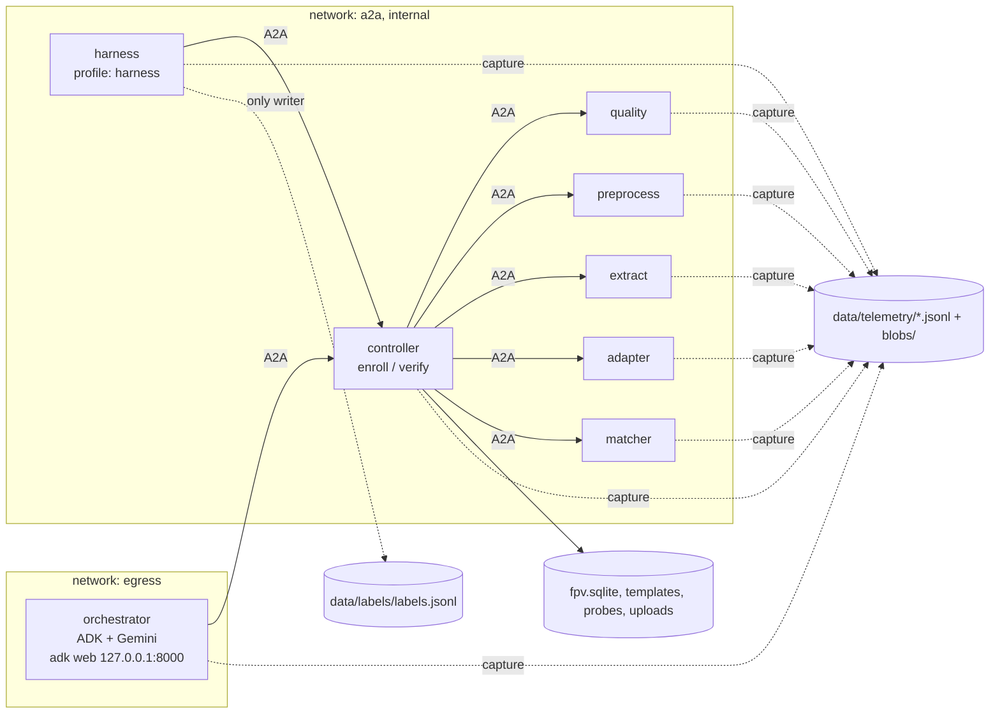

# Design Document: A2A Agents and Telemetry Capture (Phase 2)

## Overview

The phase 1 `PipelineController` already takes its stages through the `Stages` protocol (`assess_quality`, `preprocess`, `quality_after`, `extract`, `adapt`, `match`). Phase 2 adds:

- `A2AStages`, a client-side implementation of that protocol, where each method is one A2A call.
- One small A2A server per stage, which calls the matching `LocalStages` method.
- A controller A2A server that runs the unchanged `PipelineController` with `A2AStages`.
- A telemetry layer (server middleware and a client httpx hook) that writes every hop to JSONL.

The controller logic, storage, attempt loop and `stage_events` do not change. Parity with phase 1 is tested by running the same inputs through `LocalStages` and `A2AStages`.

Design principles:

- **Deterministic core.** Only the orchestrator calls an LLM. The harness never does.
- **Capture on the wire.** Telemetry records what HTTP carried (bytes, timing, JSON-RPC bodies), not what application code chose to log.
- **One writer per file.** Each process role writes its own JSONL file. The controller is the only writer of `fpv.sqlite`. (A host reader and a container writer on one SQLite file corrupted a phase 1 database once.)
- **Labels off the wire.** Uploads are stored by SHA-256 with no filename, and labels live only in `data/labels/labels.jsonl`.

## Architecture



### Framework choice

| Component | Library | Reason |
|---|---|---|
| Stage agents, controller | `a2a-sdk` 1.3.0 (`AgentExecutor`, `DefaultRequestHandlerV2`, `InMemoryTaskStore`, Starlette JSON-RPC routes) on `uvicorn` | No LLM machinery. Direct control of the message shape, which is what the study measures. |
| A2A clients (controller, harness, orchestrator) | `a2a-sdk` client over a shared `httpx.AsyncClient` | One code path, so a controller hop looks the same in both arms. The capture hook attaches to the httpx client. |
| Orchestrator | `google-adk` `LlmAgent` with function tools | Vertex Gemini, callbacks for guardrails, `adk web`. ADK's `RemoteA2aAgent` is not used: it converts A2A messages to ADK text events, which cannot carry our file and data parts. |

The A2A binding is JSON-RPC over HTTP, spec 1.0, with no streaming. Every call is `SendMessage` with a blocking configuration, and the response carries the final task.

## Components and Interfaces

### `fpv.agents.codec`

This module converts between the phase 1 dataclasses and A2A parts (`a2a.types.Part`, protobuf).

| Contract | Parts |
|---|---|
| raw image (`np.ndarray`) | raw part `image/png`, name `image` |
| `AttemptConfig` + `configuration_id` | data part `{"attempt": {...}, "configuration_id": ...}` |
| `PreprocessResult` | raw parts `enhanced` and `mask` (PNG) + data part with `attempt`, `scale_factor`, `original_shape`, `configuration_id`, `timings_ms` |
| `QualityResult` | data part with every field |
| `ExtractionResult` | data part `{"minutiae": [[x, y, direction, type, quality], ...], "count", "configuration_id", "duration_ms"}`, rebuilt as pyfing `Minutia` |
| `XytTemplate` | raw part `text/plain` holding the `.xyt` text + data part `{"count", "adapter_version"}` |
| `MatchResult` | data part with every field |
| sample upload | raw part `application/octet-stream` (original bytes, no filename) + data part `{"user_id", "hand", "finger"}` |

- Floats survive exactly because JSON uses `repr` round-trip formatting. Python ints stay ints.
- PNG is lossless for uint8 arrays, so decode(encode(a)) is byte-identical.
- `ErrorCode` is a `StrEnum`. A failed or rejected task carries a status message with a data part `{"error_code", "error_type", "error", ...}`.
- The client maps codes back to exceptions:
  - `nfiq2_tool_error` → `QualityToolError`
  - `insufficient_minutiae` → `InsufficientMinutiae(which, count)`
  - `bozorth3_tool_error` → `MatcherError`
  - anything else → `RemoteStageError`, whose `str` is the remote message

### `fpv.agents.serve`

- `StageExecutor(skill_fn, decode, encode)`: an `AgentExecutor` that does the following:
  1. Decodes the request message parts. A decode error ends the task `rejected` with `invalid_input`.
  2. Runs `skill_fn` in a worker thread, so the event loop keeps serving card requests.
  3. Ends `completed` with the encoded artifact, or `failed` with the error code.
- One executor per agent dispatches on the `skill` metadata key, because the quality agent has two skills.
- Agents run single-process, with one request at a time per agent (an `asyncio.Lock`). This matches phase 1's serial execution and keeps timing features free of contention.
- `python -m fpv.agents.serve <name> [--port]` builds the Starlette app, which serves the AgentCard, the JSON-RPC routes and the telemetry middleware. On startup it loads models and runs one warm-up call.

| Agent | Skills | Phase 1 call |
|---|---|---|
| `quality` | `assess_quality`, `quality_after` | `LocalStages.assess_quality`, `.quality_after` |
| `preprocess` | `preprocess` | `LocalStages.preprocess` |
| `extract` | `extract` | `LocalStages.extract` |
| `adapter` | `adapt` | `LocalStages.adapt` |
| `matcher` | `match` | `LocalStages.match` on two `.xyt` files written to a temp dir |
| `controller` | `enroll`, `verify` | `PipelineController(conf, repo, catalog, A2AStages(...))` |

### `fpv.agents.client`

- `A2AClient(base_url, agent, telemetry)` wraps one `httpx.AsyncClient` with the capture hook. `call(skill, parts, metadata, context_id=None, task_id=None)` sends the message and returns the final `Task`.
- `A2AStages(peers, ...)` is the synchronous `Stages` implementation used by the synchronous `PipelineController`. It runs a private event loop on a background thread and submits coroutines to it.
- Metadata on every stage call: `skill`, `parent_task_id`, `trial_id`, `control_mode`. These come from a `contextvars.ContextVar` that the controller sets for the duration of a run.

### Controller agent

- `enroll` or `verify`:
  1. Decode the sample and the claim.
  2. Write `uploads/<sha256>.bmp`.
  3. Set the run contextvar.
  4. Call `PipelineController.enroll` or `.verify` with `session_id = contextId` and `presentation_no` = this session's count + 1.
  5. Map the outcome to a task state.
- Task state mapping:

| Outcome | Task state |
|---|---|
| `REJECTED_QUALITY` / `REJECTED_MINUTIAE`, presentations left | `input-required`, with the outcome |
| the same, at `max_presentations` | `rejected`, with the outcome and `reason=presentation_limit` |
| any other status (including `ERROR`) | `completed`, with the outcome |
| invalid upload or claim | `rejected`, `invalid_input` |

- A2A 1.0 continues an interrupted task when the next message carries the same `taskId`. The harness and orchestrator send the next presentation with the `taskId` and `contextId` from the `input-required` response. The controller counts presentations per `contextId` in memory.
- Each call creates its own `PipelineController` and `Repository`. SQLite runs in WAL mode, and calls are serialized by the agent lock.
- The catalog is loaded once, so `Catalog.record` gets split and exclusion data. Uploads have no SOCOFing filename, so `label` is `None`, which makes `ground_truth_genuine` `None`.

### `fpv.telemetry`

- `TelemetryWriter(dir, role)`: a thread-safe append-only JSONL writer, `data/telemetry/<role>.jsonl`, plus a blob store `blobs/<sha256>` written with create-exclusive semantics (dedupe across processes).
- `TelemetryMiddleware`: a pure ASGI middleware. It buffers the request body and response body, records monotonic ns at request receipt and after the last response byte, and records the HTTP status. For POSTs to the JSON-RPC route it parses both bodies.
- Client hook: an `httpx.AsyncClient` transport wrapper (`CapturingTransport`). It records the request bytes as sent and the response bytes as received, with monotonic ns around `handle_async_request`. A transport wrapper sees the exact bytes and timing, which `event_hooks` cannot provide for response bodies without consuming the stream.
- Hop record (`schema_version: 1`):

```json
{"schema_version": 1, "side": "server|client", "role": "quality", "agent": "quality", "peer": "controller",
 "t_wall": "...Z", "t_start_ns": 0, "t_end_ns": 0, "latency_ms": 0.0,
 "http_method": "POST", "path": "/", "http_status": 200, "rpc_method": "SendMessage",
 "skill": "preprocess", "task_id": "...", "context_id": "...", "parent_task_id": "...",
 "trial_id": "...", "control_mode": "controller", "warmup": false, "image_digest": "sha256:...",
 "final_state": "TASK_STATE_COMPLETED", "state_history": ["TASK_STATE_SUBMITTED", "..."],
 "error_code": null, "req_bytes": 0, "resp_bytes": 0,
 "req_parts": {"raw": 1, "data": 1}, "resp_parts": {"raw": 2, "data": 1},
 "req_body": {}, "resp_body": {}}
```

- Raw-part bytes inside stored bodies are replaced by `{"$blob": "<sha256>", "len": n}`, and `restore(body)` puts them back.
- Agent names: the server knows its own name. The client knows the peer from its target URL. The server learns the caller from the `X-FPV-Agent` request header, which the client sets. The header is part of the open-system assumption and is recorded on both sides.
- `FPV_TELEMETRY=off` disables capture. The test suite asserts that outputs do not change.
- `image_digest` comes from `FPV_IMAGE_DIGEST`, which compose sets from the build.

### Orchestrator (`src/fpv_orchestrator/agent.py`)

- An ADK `Agent` (`LlmAgent`) with `model=os.environ["FPV_MODEL_ID"]` (default `gemini-3.8-flash`) on Vertex AI (`GOOGLE_GENAI_USE_VERTEXAI=TRUE`, `GOOGLE_CLOUD_PROJECT`, `GOOGLE_CLOUD_LOCATION`). Credentials come from ADC: only `~/.config/gcloud/application_default_credentials.json` is mounted, read-only, at `/run/secrets/adc.json`.
- Uploads: `before_model_callback` scans the last user turn for inline image parts. It saves them to `uploads/<sha256>`, replaces them with the text `[sample_ref: <sha256>]`, and records the ref in session state. The model therefore never receives pixels (Req 9.6).
- Tools:
  - `confirm_claim(user_id, hand, finger)`: stores `pending_claim`. The next user turn must say yes for it to become `confirmed_claim`. `before_model_callback` checks this on the next turn.
  - `enroll(sample_ref, user_id, hand, finger)` and `verify(...)`: call the controller through `A2AClient` with `control_mode=llm_routed`, keeping the per-session `taskId`/`contextId` for continuation.
- Callbacks:
  - `before_tool_callback`: argument validation and the confirmed-claim check. A failure returns an error dict and logs `guardrail_block`.
  - `after_tool_callback`: stores `last_status` and `last_message`.
  - `after_model_callback`: if the final text mentions a status word that differs from `last_status`, it replaces the text with `last_message` and logs `response_substituted`. It also records a model-call event with tokens (`usage_metadata`), latency and tool calls.
- Telemetry role `orchestrator`. Model-call and guardrail records go into the same JSONL file with `kind` set to `model_call` or `guardrail`.

### Harness (`fpv.arms`, `fpv evaluate --backend a2a`)

- `build_arm_trials(catalog, split, seed, k, per_arm)`:
  - C and C' come from `generate_trials`: genuine trials become C, impostor trials become C'.
  - A pairs each enrolled Real key with its own identity.
  - B pairs each enrolled Real key with a random different enrolled subject at the same hand and finger, using `numpy.random.default_rng([seed, h])`.
  - Each arm is sampled down to `per_arm` with a seeded RNG. All arms are interleaved with one seeded permutation.
- Enrollment happens first, one controller call per enrolled Real image. Warm-up covers the first 20 trials.
- Labels are written before each trial is sent. A trial's `trial_id` goes on the wire, and its arm does not.

### Reducer (`fpv.telemetry_features`)

- Reads all JSONL files and keeps server-side records (plus client-side latency for the same hop, joined by task ID).
- Groups stage hops by `parent_task_id` = the controller task ID, and maps the controller task to `run_id` from its response body.

| Group | Columns |
|---|---|
| T1 | total run latency; per-skill latency sum, max and count; request and response bytes per skill; total bytes |
| T2 | hop count; preprocess count (attempts); state path of the controller task; failed or rejected hops; skill bigram counts |
| T3 | `quality_before`; per-attempt `quality_after`; raw and adapted minutiae counts; enhanced PNG bytes |
| oracle | match score, decision, status |
| covariates | input bytes, width, height |
| keys | `run_id`, `trial_id`, `control_mode`, `operation`, `feature_set_version` |

- `export --labels data/labels/labels.jsonl --out features.csv` joins labels on `trial_id`.
- `negative-control` fits `LogisticRegression(l1_ratio=1, solver="liblinear")` with stratified 5-fold CV AUC per tier, on C vs B and on randomly split arm A.

## Data Models

- The phase 1 SQLite schema is unchanged. Runs get `control_mode` (`controller` or `llm_routed`) in the existing `runs.control_mode` column.
- Telemetry: JSONL as above. Labels: JSONL `{"trial_id", "arm", "genuine", "alteration", "difficulty", "subject", "claim", "probe", "split", "warmup", "seed"}`.

## Error Handling

| Condition | Behavior |
|---|---|
| Stage agent unreachable | `A2AStages` raises `RemoteStageError("unreachable")`. In the attempt loop this fails the attempt (same as a phase 1 stage exception). For `quality_before` and `match`, the controller's boundary maps it to `ERROR / unexpected_error`. |
| Telemetry write fails | Logged to stderr and never raised. Capture is passive. |
| Orchestrator model error | The orchestrator returns an error to the user without a result. No controller call is made. |
| Controller crash mid-run | `PipelineController` already ends the run with `ERROR`. The task is `completed` with that outcome. |

## Testing Strategy

- Host-only unit tests (no toolchain): codec round trips, telemetry blob replacement and restore, middleware byte counts against an in-process Starlette app, arm generation, reducer determinism.
- `toolchain` tests in the container: stage agent behavior in-process (Starlette app with `httpx.ASGITransport`), `A2AStages` vs `LocalStages` parity, and controller lifecycle.
- `dataset` + `toolchain`: end-to-end parity on seeded train trials.
- `live` tests (a new marker) run against the running compose services from the harness container, and skip when the services are unreachable.
- Orchestrator tests use a fake model (ADK callbacks invoked directly with constructed requests) and run in the orchestrator image.

## Implementation Notes

Recorded while implementing (they refine the sections above):

- **a2a-sdk 1.3.0** types are protobuf (`a2a.types`). Servers use `DefaultRequestHandlerV2` + `InMemoryTaskStore` with `create_agent_card_routes` / `create_jsonrpc_routes` on Starlette. The executor must enqueue a `Task` before any status update. Continuation of an `input-required` task is a new message with the same `task_id` and `context_id`. Clients send `SendMessageConfiguration(history_length=0)`, so responses do not echo the request parts.
- **Data parts are `google.protobuf.Value`**, so every number is a double on the wire. `codec.from_parts` turns whole doubles back into ints. Decoders cast float fields explicitly, so this is lossless. `AttemptConfig` travels as `attempt_no` + `configuration_id` and is looked up in the receiver's config, which keeps `sbmex_overrides` ints exact.
- **Minutiae** are rebuilt as a local namedtuple with pyfing's `Minutia` fields (`pyfing.definitions.Minutia`). Values compare equal, and the adapter agent does not import pyfing.
- **Remote errors** with no phase 1 exception raise a `RemoteStageError` subclass named after the remote exception type, so `AttemptRecord.error` matches phase 1.
- **Ports.** Every agent listens on 8080 inside its own container (`http://<service>:8080/`). `/healthz` returns 503 until a stage agent's startup warm-up has finished, and the middleware does not record `/healthz`.
- **Controller store.** `FPV_STORE_DIR=data/a2a`, separate from the phase 1 CLI's `data/db`.
- **`req_bytes` / `resp_bytes`** are HTTP body lengths. Headers are not counted.
- **Orchestrator.** `google-adk` 2.13.0 on `python:3.12-slim` (`requirements-orchestrator.lock`), served by `adk web /app/agents`. The Vertex switch is `GOOGLE_GENAI_USE_ENTERPRISE` (newer google-genai) or `GOOGLE_GENAI_USE_VERTEXAI`. Uploads are kept in `data/orchestrator/uploads/`.
- **Scripted `llm_routed` arm** (`fpv evaluate --backend llm_routed`) runs in the harness container and talks to the orchestrator's ADK HTTP API (`/apps/.../sessions`, `/run`), so `data/labels` stays mounted only in the harness. The session state carries `trial_id`, which the orchestrator forwards to the controller. Token counts come from the events' `usageMetadata`.
- **Known confound found in the first data.** SOCOFing Real BMPs are 24-bit (39,690 bytes) and Altered BMPs are 8-bit (10,966 bytes) at the same 96×103 size. Any arm contrast between Real and Altered probes (C vs B) is therefore trivially separable in T1 through the upload size. `cov__input_bytes` records it. Normalizing the probe encoding before sending is left to the analysis spec.
