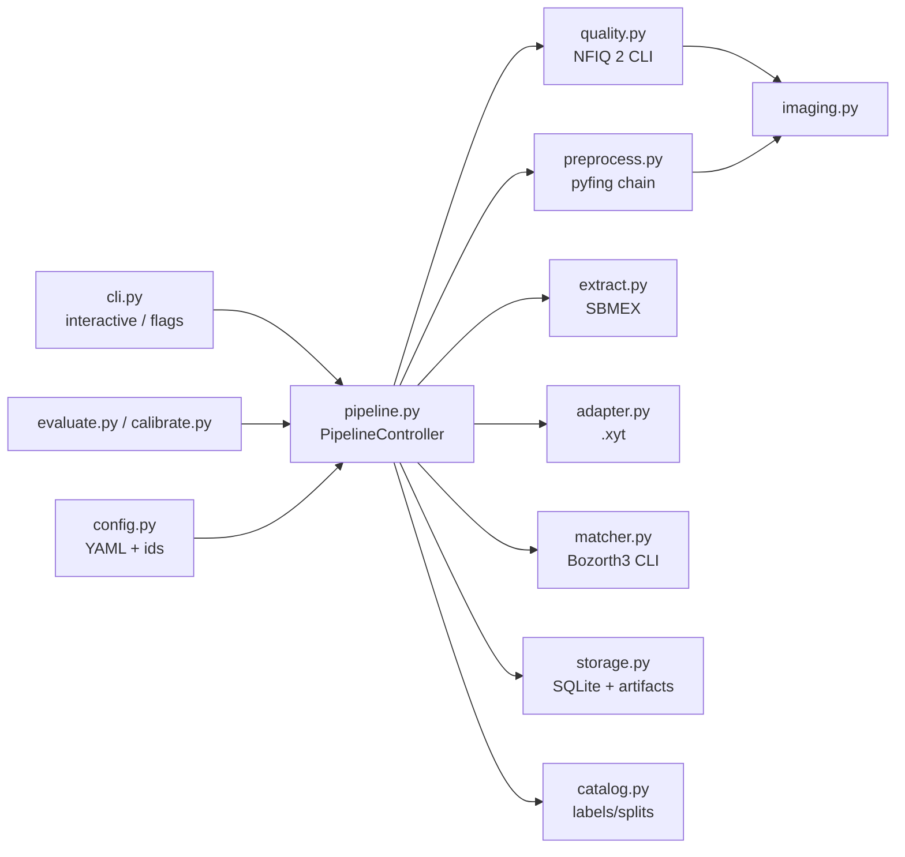
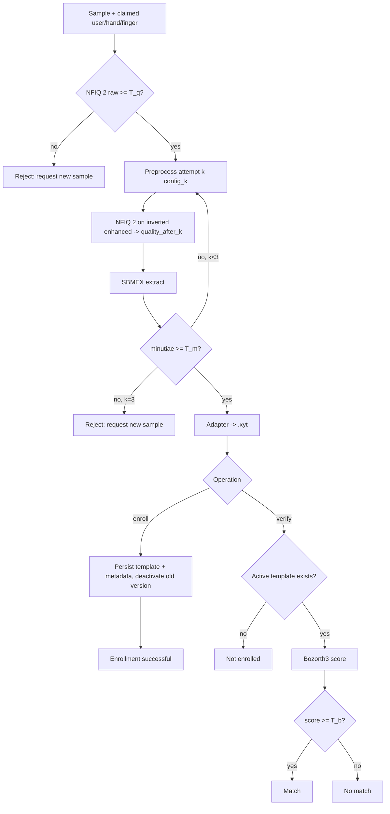

# Design Document: Fingerprint Pipeline Baseline (Phase 1)

## Overview

A deterministic Python package, `fpv`, that runs inside a single Linux container and implements SOCOFing enrollment and verification:

```
sample -> NFIQ 2 gate -> [pyfing preprocess -> NFIQ 2 quality_after -> SBMEX extract -> .xyt adapter] x <=3 attempts -> persist | Bozorth3 match
```

Design goals:

- **Determinism and traceability.** Every artifact carries a `configuration_id`, every run a `config_set_id` and `pipeline_version`.
- **Agent-ready boundaries.** Each stage is one function with frozen dataclass I/O (Requirement 15). Phase 2 wraps these functions as A2A skills without changing them.
- **Baseline telemetry.** The controller logs every stage invocation in-process. Phase 2 compares A2A telemetry against this log.
- **No egress.** Phase 1 runs with networking disabled at runtime (Requirement 1.6).

## Architecture



### Repository layout

```
docker/Dockerfile              # nbis-builder stage -> runtime stage
docker-compose.yml             # service `fpv`, data mounts, network_mode: none
configs/pipeline.v1.yaml       # provisional config (thresholds, attempts, pins, paths)
configs/pipeline.v1.frozen.yaml  # written by Task 12
pyproject.toml                 # package `fpv` (src layout), console script `fpv`, pytest markers
src/fpv/
  __init__.py     # __version__
  types.py        # Hand, Finger, Identity, Status enums/dataclasses
  config.py       # load/validate config, canonical JSON, configuration_id, config_set_id, pipeline_version
  catalog.py      # SOCOFing label parsing, split/exclusion lookup, SampleRecord
  imaging.py      # load_gray8, clahe, resize, invert, apply_mask, write_png, temp_png
  quality.py      # assess_quality, quality_gate
  preprocess.py   # AttemptConfig, preprocess, quality_after
  extract.py      # extract (SBMEX)
  adapter.py      # to_xyt, write_xyt, read_xyt
  matcher.py      # match, decide
  storage.py      # Repository, migrations, artifact paths
  pipeline.py     # Stages protocol, PipelineController.enroll/verify
  cli.py          # fpv doctor|catalog|quality|preprocess|extract|match|enroll|verify|evaluate|calibrate
  evaluate.py     # trial generation, parallel execution, metrics, DET plot
  calibrate.py    # threshold selection, sweeps, freeze, test-split guard
  migrations/0001_init.sql
scripts/characterize.py
tests/            # unit + `toolchain` + `dataset` markers
```

The `fpv` CLI exists from Task 1 (`fpv doctor`). Each later task registers its diagnostic subcommand, so no module is ever unreachable from the CLI.

## Components and Interfaces

All dataclasses are `@dataclass(frozen=True, slots=True)`. Image arrays are `np.ndarray` (`uint8`, 2-D) in-process and are serialized as PNG bytes when they cross a process or agent boundary (phase 2).

### `types.py`

```python
class Hand(StrEnum):   LEFT = "Left"; RIGHT = "Right"
class Finger(StrEnum): THUMB = "thumb"; INDEX = "index"; MIDDLE = "middle"; RING = "ring"; LITTLE = "little"

@dataclass(frozen=True, slots=True)
class Identity:
    user_id: int          # 1..600 (validated in __post_init__)
    hand: Hand
    finger: Finger

class Status(StrEnum):
    ENROLLED = "ENROLLED"; REJECTED_QUALITY = "REJECTED_QUALITY"; REJECTED_MINUTIAE = "REJECTED_MINUTIAE"
    MATCH = "MATCH"; NO_MATCH = "NO_MATCH"; NOT_ENROLLED = "NOT_ENROLLED"; ERROR = "ERROR"
```

`Identity.parse(user, hand, finger)` normalizes case and raises `ValueError` with the allowed values. Both the CLI and the catalog use it.

### `catalog.py`

```python
Alteration = Literal["Real", "Obl", "CR", "Zcut"]
Difficulty = Literal["Real", "Easy", "Medium", "Hard"]

@dataclass(frozen=True, slots=True)
class SampleLabel:
    identity: Identity
    gender: Literal["M", "F"]
    alteration: Alteration
    difficulty: Difficulty

@dataclass(frozen=True, slots=True)
class SampleRecord:
    sample_id: str              # "s_" + sha256(f"{sha256}:{source_path}")[:16]
    source_path: str            # relative to data/raw when inside it, else absolute
    sha256: str
    width: int
    height: int
    label: SampleLabel | None   # None => unlabeled (Req 2.2)
    split: str | None           # train | validation | test | None
    excluded: bool

def parse_label(path: Path) -> SampleLabel | None
class Catalog:
    @classmethod
    def load(cls, splits_csv: Path, exclusions_csv: Path, raw_root: Path) -> "Catalog"
    def record(self, path: Path) -> SampleRecord
    def iter_samples(self, split: str, *, real: bool | None = None) -> Iterator[SampleRecord]
```

- The regex reuses `validate_labels.py`: `^(\d+)__(M|F)_(Left|Right)_(little|ring|middle|index|thumb)_finger(?:_(Obl|CR|Zcut))?\.bmp$` with `re.IGNORECASE`.
- Difficulty comes from the parent directory (`Altered-Easy` gives `Easy`, `Real` gives `Real`).
- `sample_id` combines the content hash and the path. SOCOFing has byte-identical files under conflicting labels, so a content hash alone would collide.

### `imaging.py`

```python
def load_gray8(path: Path) -> np.ndarray                 # raises InputImageError
def clahe(img, clip_limit: float, tile: int) -> np.ndarray
def resize(img, scale: float) -> np.ndarray               # INTER_CUBIC; scale==1.0 returns a copy
def invert(img) -> np.ndarray
def apply_mask(img, mask, background: int = 255) -> np.ndarray
@contextmanager
def temp_png(img) -> Iterator[Path]                       # 8-bit gray PNG in a private temp dir
def png_bytes(img) -> bytes; def from_png_bytes(b: bytes) -> np.ndarray
```

### `quality.py`

```python
@dataclass(frozen=True, slots=True)
class QualityResult:
    score: int | None                      # None => NFIQ 2 could not score (Req 4.3 / 5.6)
    actionable_feedback: Mapping[str, float]
    raw_output: str
    tool_version: str
    duration_ms: float

@dataclass(frozen=True, slots=True)
class GateDecision:
    passed: bool
    score: int | None
    threshold: int
    reason: str | None                     # "below_threshold" | "nfiq2_failed" | None

class QualityToolError(Exception)          # binary missing/timeout/crash/non-zero exit/unparseable -> Status.ERROR

@dataclass(frozen=True, slots=True)
class QualitySettings:
    upscale: float                         # quality.nfiq2_upscale (default 3.0)
    nfiq2_bin: str = "nfiq2"; timeout_s: float = 30.0; tool_version: str = "unknown"
    @classmethod
    def from_config(cls, conf: PipelineConfig, **overrides) -> "QualitySettings"

# QualityResult also carries: upscale, error (NFIQ 2 OptionalError when score is None), scored_shape
def assess_quality(image: np.ndarray, settings: QualitySettings, *,
                   runner: Callable[..., CompletedProcess] = subprocess.run) -> QualityResult
def parse_nfiq2_output(stdout: str) -> ParsedOutput   # score, actionable feedback, error
def quality_gate(result: QualityResult, threshold: int) -> GateDecision
```

- The image is bicubic-upscaled by `settings.upscale`, written with `temp_png` and run as `[nfiq2_bin, "-F", "-a", str(path)]` (`NFIQ2_FLAGS`) with `shell=False` and `stdin=DEVNULL`.
- Parsing is unit-tested against the captured output fixtures. Actionable feedback is the four NFIQ 2 actionable columns; `NA` values are omitted.
- `fpv quality` exits 0 on PASS, 20 on FAIL and 1 on a tool error.
- A "cannot compute" result, such as a blank image or a FingerJet failure, maps to `score=None`. A missing binary, timeout or signal raises `QualityToolError`.

### `preprocess.py`

```python
@dataclass(frozen=True, slots=True)
class ClaheConfig: clip_limit: float = 2.0; tile: int = 8

@dataclass(frozen=True, slots=True)
class AttemptConfig:
    attempt_no: int
    name: str                                         # "traditional" | "deep" | "deep_boost"
    segmentation: Literal["GMFS", "SUFS"]
    orientation: Literal["GBFOE", "SNFOE"]
    frequency: Literal["XSFFE", "SNFFE"]
    enhancement: Literal["GBFEN", "SNFEN"]
    clahe: ClaheConfig | None = None
    upscale: float = 1.0                              # passes dpi = 500 * upscale to pyfing
    resample: float = 1.0                             # Task 5: resample treated as native 500 ppi (pyfing dpi unchanged)
    # scale_factor property = resample * upscale
    sbmex_overrides: Mapping[str, float | int | str] = field(default_factory=dict)

@dataclass(frozen=True, slots=True)
class PreprocessResult:
    attempt: AttemptConfig
    enhanced: np.ndarray        # uint8, white ridges on black (pyfing convention)
    mask: np.ndarray            # uint8 {0,255}
    scale_factor: float         # == attempt.scale_factor (resample * upscale)
    original_shape: tuple[int, int]   # (H, W) of the raw sample
    configuration_id: str
    timings_ms: Mapping[str, float]   # segmentation/orientation/frequency/enhancement

def preprocess(image: np.ndarray, attempt: AttemptConfig, *, configuration_id: str) -> PreprocessResult
def quality_after(result: PreprocessResult, *, assess=assess_quality) -> QualityResult
```

- Every attempt starts from the raw sample (Req 5.3), applying the `resample`, then optional CLAHE, then the `upscale`.
- pyfing algorithm objects are cached per process in a module-level registry, so Keras weights load once.
- Determinism: `keras.utils.set_random_seed(0)`, `tf.config.experimental.enable_op_determinism()` and CPU-only execution inside the container. Task 4 tests verify byte-identical output across repeated calls.
- `quality_after` computes `apply_mask(invert(enhanced), mask, background=255)`. It downsamples by `1/scale_factor` to the original size and then scores it with the same `QualitySettings` (so the same `nfiq2_upscale`) as `quality_before`.

### `extract.py`

```python
@dataclass(frozen=True, slots=True)
class ExtractionResult:
    minutiae: tuple[pyfing.Minutia, ...]
    count: int
    configuration_id: str
    duration_ms: float

def extract(pre: PreprocessResult) -> ExtractionResult
```

`extract` builds `Sbmex(SbmexParameters(**{**defaults, **pre.attempt.sbmex_overrides}))`, cached per overrides key, and calls `run(pre.enhanced, pre.mask, dpi=500)`. Unknown override names raise `ValueError`. LEADER is never referenced (Req 6.2). (`import pyfing` still loads the module that defines it, because pyfing's `__init__` imports everything.) Minutia coordinates are in pixels of the enhanced image, so they are scaled by `scale_factor`. The Sbmex class used is a subclass whose `_encode_neighborhood` is a pure-numpy version of pyfing's `filter2D` call (see Task 5 findings).

### `adapter.py`

```python
ADAPTER_VERSION = "xyt-adapter/1"

@dataclass(frozen=True, slots=True)
class XytMinutia: x: int; y: int; theta: int; quality: int

@dataclass(frozen=True, slots=True)
class XytTemplate:
    minutiae: tuple[XytMinutia, ...]
    adapter_version: str = ADAPTER_VERSION
    @property
    def count(self) -> int
    def lines(self) -> list[str]            # "x y theta q"

def to_xyt(minutiae: Sequence[Minutia], original_shape: tuple[int, int], scale_factor: float) -> XytTemplate
def write_xyt(t: XytTemplate, path: Path) -> None     # atomic: tmp file + os.replace
def read_xyt(path: Path) -> XytTemplate
```

#### `.xyt` conversion math

pyfing gives `(x, y)` in pixels of the (possibly upscaled) image with a top-left origin. Its `direction` is computed as `atan2(-dy, dx)`, so it is already counterclockwise with y pointing up. Bozorth3 expects a bottom-left origin and integer degrees.

```
x' = clip(round(x / s), 0, W - 1)
y' = clip((H - 1) - round(y / s), 0, H - 1)
θ  = round(degrees(direction)) mod 360        # round first, so 359.6 -> 360 -> 0
q  = clamp(round(quality * 100), 0, 100)
```

- **No angle negation is needed.** Flipping the y-axis converts the y-down image frame to a y-up frame, and pyfing's `-dy` has already expressed the angle in that frame.
- **Dedup.** For each `(x', y')` keep the highest `q`, breaking ties by the lowest `θ`. Then sort by `(y', x', θ)`.
- **Rotation property.** Rotating synthetic minutiae by φ about the image center (with consistent coordinate rotation) shifts every θ by φ mod 360. A test asserts this, which guards the sign convention.
- **Why it's robust.** Bozorth3 compares relative angles and distances between minutia pairs. A constant angular offset can't change scores, but a sign error can. The rotation test detects sign errors.
- **Python's `round`.** It uses banker's rounding. The adapter uses `math.floor(v + 0.5)` for explicit half-up rounding, and the tests pin this behavior.

### `matcher.py`

```python
MIN_BOZORTH_MINUTIAE = 10

@dataclass(frozen=True, slots=True)
class MatchResult:
    score: int
    probe_count: int
    gallery_count: int
    tool_version: str
    duration_ms: float

class InsufficientMinutiae(Exception):   # attrs: which: Literal["probe","gallery"], count, minimum
class MatcherError(Exception)            # missing binary, non-zero exit, timeout, unparseable output

def match(probe: Path, gallery: Path, *, bozorth3_bin: str = "bozorth3", timeout_s: float = 30,
          runner=subprocess.run) -> MatchResult
def decide(score: int, threshold: int) -> Literal[Status.MATCH, Status.NO_MATCH]
```

The command is `[bozorth3_bin, str(probe), str(gallery)]` with `shell=False`. stdout is parsed as one integer. The NIST internal `.xyt` convention (no `-m1`) is the assumed default, confirmed in the Task 1/7 spike with a self-match sanity check.

### `storage.py`

```python
class Repository:
    def __init__(self, db_path: Path, templates_root: Path, probes_root: Path)   # WAL, foreign_keys=ON
    def migrate(self) -> None
    def upsert_sample(self, rec: SampleRecord) -> None
    def start_run(self, run: RunStart) -> None
    def finish_run(self, run_id: str, status: Status, reason: str | None, attempts_used: int) -> None
    def log_stage_event(self, ev: StageEvent) -> None
    def enroll_template(self, identity: Identity, xyt: XytTemplate, meta: TemplateMeta) -> TemplateRow
    def get_active_template(self, identity: Identity) -> TemplateRow | None
    def list_templates(self, identity: Identity) -> list[TemplateRow]
    def write_probe(self, run_id: str, xyt: XytTemplate) -> Path
    def record_verification(self, v: VerificationRow) -> None
```

`enroll_template` sequence:

1. `BEGIN IMMEDIATE`
2. Compute `next_version` as `max(template_version) + 1`
3. Write the `.xyt` atomically to `v<n>.xyt`
4. `UPDATE ... SET is_active=0` for the identity
5. `INSERT` the new row with `is_active=1`
6. `COMMIT`

On any exception it rolls back, unlinks the new file and re-raises (Req 8.6). All SQL is parameterized.

### `pipeline.py`

```python
class Stages(Protocol):
    def assess_quality(self, image: np.ndarray) -> QualityResult: ...
    def preprocess(self, image: np.ndarray, attempt: AttemptConfig, configuration_id: str) -> PreprocessResult: ...
    def quality_after(self, pre: PreprocessResult) -> QualityResult: ...
    def extract(self, pre: PreprocessResult) -> ExtractionResult: ...
    def adapt(self, ex: ExtractionResult, pre: PreprocessResult) -> XytTemplate: ...
    def match(self, probe: Path, gallery: Path) -> MatchResult: ...

@dataclass(frozen=True, slots=True)
class AttemptRecord: attempt_no: int; configuration_id: str; quality_after: int | None; minutiae_count: int

@dataclass(frozen=True, slots=True)
class EnrollmentOutcome:
    run_id: str; status: Status; reason: str | None; message: str
    quality_before: int | None; attempts: tuple[AttemptRecord, ...]
    template_id: str | None; template_version: int | None

@dataclass(frozen=True, slots=True)
class VerificationOutcome:
    run_id: str; status: Status; reason: str | None; message: str
    quality_before: int | None; attempts: tuple[AttemptRecord, ...]
    template_id: str | None; score: int | None; threshold: int
    ground_truth_genuine: bool | None

class PipelineController:
    def __init__(self, config: PipelineConfig, repo: Repository, catalog: Catalog,
                 stages: Stages = LocalStages(), clock: Clock = SystemClock(),
                 probe_cache: ProbeCache | None = None): ...
    def enroll(self, sample_path: Path, identity: Identity, *, session_id: str, presentation_no: int) -> EnrollmentOutcome
    def verify(self, sample_path: Path, identity: Identity, *, session_id: str, presentation_no: int) -> VerificationOutcome
```

- `_stage(name, attempt_no, configuration_id)` is a context manager that times each call with `perf_counter_ns` and writes a `stage_events` row. On an exception it writes `outcome="error"` with the exception type (Req 11.5).
- Stage names: `load`, `quality_before`, `preprocess`, `quality_after`, `extract`, `adapt`, `persist`, `lookup`, `match`, `decide`.
- A shared private method `_acquire(image) -> Acquired | Rejection` runs the gate and the attempt loop. Enrollment and verification both use it (Req 4.7, 5.7).
- `probe_cache` is only injected by `evaluate.py`. It is keyed by `(sample sha256, config_set_id)` and logs `details_json.cache_hit`.
- The controller never prompts or prints (Req 15.2).

### `cli.py`

- argparse subcommands: `doctor`, `catalog`, `quality`, `preprocess`, `extract`, `match`, `enroll`, `verify`, `evaluate`, `calibrate`, plus a global `--config`.
- The session loop belongs to the CLI. It holds a `session_id` and up to `max_presentations` runs, and asks for a new sample on `REJECTED_*` (Req 10).
- `input_fn` and `output_fn` are injectable for tests.
- Exit codes:

| Status | Code |
|---|---|
| `ENROLLED` / `MATCH` | 0 |
| `NO_MATCH` | 10 |
| `NOT_ENROLLED` | 11 |
| `REJECTED_QUALITY` | 20 |
| `REJECTED_MINUTIAE` | 21 |
| Presentation limit reached | 22 |
| Invalid input (non-interactive) | 2 |
| `ERROR` | 1 |

### `evaluate.py` and `calibrate.py`

- **Trial generation** is a pure function of `(catalog, split, seed, k, subjects)` that returns ordered `Trial(trial_id, probe, claim, genuine)` records.
- **Impostor sampling** uses `numpy.random.default_rng(seed)` over sorted candidate lists, so the trial list doesn't depend on worker count (Req 13.5).
- **Execution** uses a `ProcessPoolExecutor` with per-worker `Repository` connections (WAL). Workers process probes in deterministic chunks, and results are sorted by `trial_id` before writing.
  - Task 11 implementation: one work unit per (hand, finger) position (its Real enrollments plus every trial claiming it; impostors share hand and finger, so units are independent). Each unit has its own store, `eval/<split>/<config_set_id>/store/<Hand>_<finger>/` (`fpv.sqlite`, `templates/`, `probes/`), instead of one shared WAL DB: the eval directory is a Docker bind mount, where the WAL index is not shared with host-side readers (a host `sqlite3` read corrupted a live DB in the first demo run), and the unit-to-store mapping is independent of the worker count. Each unit's DB is written on container-local temp storage, checkpointed, switched to `journal_mode=DELETE` and moved into the store when the unit finishes. The store is recreated on each run. The probe cache is per unit and in memory; `quality_before.details.cache_hit` is `true` on a replay and `false` on a miss. `scores.csv` and `enrollments.csv` also carry per-attempt minutiae counts and `quality_after` for the Task 12 sweeps. Probes whose own finger has no non-excluded Real sample are skipped and counted. When FTA is 1, gFMR is 0 and gFNMR is 1.
- **Metrics**:
  - `fte = 1 - enrolled / attempted_enrollments`
  - `fta = rejected_probes / probes`
  - `fmr(t) = |impostor scores ≥ t| / |impostor comparisons|`
  - `fnmr(t) = |genuine scores < t| / |genuine comparisons|`
  - Generalized rates: `gfmr = (1 - fta) * fmr` and `gfnmr = fta + (1 - fta) * fnmr` (ISO/IEC 19795-1 style)
- **DET plot** uses matplotlib with normal-deviate axes.
- **Calibration**: `threshold_at(fmr_target) = min{t ∈ ℤ≥0 : fmr(t) ≤ target}`. `freeze()` writes the frozen YAML through `config.py`, which recomputes `config_set_id`. The test-split guard looks for `data/quality_reports/test_report_<config_set_id>.json`.
  - Task 12 implementation: `fpv calibrate` reads only `eval/{train,validation}/<provisional config_set_id>/` (`check_calibration_input` rejects any other path, so test-split files are never opened) and refuses a frozen source config or an existing frozen file without `--force`. It writes `calibration/<config_set_id>/calibration.md` and `calibration.json`, and the frozen YAML: `frozen: true`, `bozorth3_match` = the primary point's threshold, `calibration.operating_points` (both targets, hashed) and `provenance` (date, `pipeline_version`, source runs with SHA-256 digests, decisions; not hashed). `--nfiq2-min` / `--minutiae-min` apply sweep-based gate changes. The FTE/FTA sweeps replay the recorded raw NFIQ 2 scores and per-attempt adapted counts; cells that would need an attempt that never ran (a higher `minutiae_min`) or a sample that was never processed (a lower `nfiq2_min`) are reported as a low–high range. `fpv evaluate --split test` requires `frozen: true`, refuses `--subjects`, and refuses when the test report exists unless `--force` (the new report sets `forced`, `override` and a `history` of replaced runs). On completion it writes `test_report_<config_set_id>.json` and `baseline_v1.md`.

## Data Models

### Configuration (`configs/pipeline.v1.yaml`, provisional)

```yaml
schema_version: 1
frozen: false
thresholds:
  nfiq2_min: 5
  minutiae_min: 12
  bozorth3_match: 40
session:
  max_presentations: 3
quality:
  nfiq2_upscale: 3.0   # fixed bicubic upscale before NFIQ 2 (1.0-4.0)
preprocess:
  max_attempts: 3
  attempts:
    - {attempt_no: 1, name: traditional, segmentation: GMFS, orientation: GBFOE, frequency: XSFFE, enhancement: GBFEN, resample: 3.0}
    - {attempt_no: 2, name: deep, segmentation: SUFS, orientation: SNFOE, frequency: SNFFE, enhancement: SNFEN, resample: 3.0}
    - {attempt_no: 3, name: deep_boost, segmentation: SUFS, orientation: SNFOE, frequency: SNFFE, enhancement: SNFEN,
       resample: 3.0, clahe: {clip_limit: 2.0, tile: 8}, sbmex_overrides: {minimum_background_distance: 4}}
adapter:
  version: xyt-adapter/1
evaluation:
  seed: 42
  impostors_per_probe: 5
calibration:
  target_fmrs: [0.001, 0.01]
  primary_target_fmr: 0.01
tools:
  nfiq2: "2.3.0"
  nbis: "5.0.0"
  pyfing: "0.7.3"
paths:
  raw: data/raw
  splits: data/processed/dataset_splits.csv
  exclusions: data/quality_reports/duplicate_exclusions.csv
  templates: data/templates
  probes: data/probes
  db: data/db/fpv.sqlite
  reports: data/quality_reports
```

The attempts, `minutiae_min` and `nfiq2_min` were finalized by the Task 5 characterization study (see Open Decisions). `bozorth3_match` remains provisional until Task 12.

### Identifier scheme

| Identifier | Definition |
|---|---|
| `configuration_id` | `"cfg_" + sha256(canonical_json({"attempt": attempt, "adapter": adapter.version, "tools": tools}))[:12]` |
| `config_set_id` | `"cs_" + sha256(canonical_json(entire config minus provenance))[:12]` |
| `canonical_json` | `json.dumps(obj, sort_keys=True, separators=(",", ":"), ensure_ascii=True)`, with floats normalized via `repr` |
| `pipeline_version` | `f"{fpv.__version__}+g{short_sha}"`, plus `.dirty` if needed; `GIT_COMMIT` env inside the container; `+unknown` otherwise |
| `template_id`, `run_id`, `session_id` | UUID4 strings |

### SQLite schema (`src/fpv/migrations/0001_init.sql`)

```sql
PRAGMA foreign_keys = ON;

CREATE TABLE schema_migrations (version INTEGER PRIMARY KEY, applied_at TEXT NOT NULL);

CREATE TABLE samples (
  sample_id   TEXT PRIMARY KEY,
  source_path TEXT NOT NULL,
  sha256      TEXT NOT NULL,
  subject_id  INTEGER, hand TEXT, finger TEXT, alteration TEXT, difficulty TEXT, split TEXT,
  excluded    INTEGER NOT NULL DEFAULT 0 CHECK (excluded IN (0,1)),
  width       INTEGER NOT NULL,
  height      INTEGER NOT NULL,
  created_at  TEXT NOT NULL
);

CREATE TABLE templates (
  template_id       TEXT PRIMARY KEY,
  user_id           INTEGER NOT NULL CHECK (user_id BETWEEN 1 AND 600),
  hand              TEXT NOT NULL CHECK (hand IN ('Left','Right')),
  finger            TEXT NOT NULL CHECK (finger IN ('thumb','index','middle','ring','little')),
  template_location TEXT NOT NULL,
  source_sample_id  TEXT NOT NULL REFERENCES samples(sample_id),
  quality_before    INTEGER NOT NULL,
  quality_after     TEXT NOT NULL,          -- JSON [{attempt_no, configuration_id, score|null}]
  minutiae_count    INTEGER NOT NULL,
  scale_factor      REAL NOT NULL,
  pipeline_version  TEXT NOT NULL,
  configuration_id  TEXT NOT NULL,
  template_version  INTEGER NOT NULL,
  is_active         INTEGER NOT NULL CHECK (is_active IN (0,1)),
  created_at        TEXT NOT NULL,
  UNIQUE (user_id, hand, finger, template_version)
);
CREATE UNIQUE INDEX ux_templates_one_active ON templates(user_id, hand, finger) WHERE is_active = 1;

CREATE TABLE runs (
  run_id              TEXT PRIMARY KEY,
  session_id          TEXT NOT NULL,
  presentation_no     INTEGER NOT NULL,
  operation           TEXT NOT NULL CHECK (operation IN ('enroll','verify')),
  claimed_user_id     INTEGER NOT NULL,
  claimed_hand        TEXT NOT NULL,
  claimed_finger      TEXT NOT NULL,
  sample_id           TEXT REFERENCES samples(sample_id),
  status              TEXT,
  status_reason       TEXT,
  attempts_used       INTEGER NOT NULL DEFAULT 0,
  control_mode        TEXT NOT NULL DEFAULT 'controller',
  orchestrator_vision TEXT NOT NULL DEFAULT 'off',
  pipeline_version    TEXT NOT NULL,
  config_set_id       TEXT NOT NULL,
  started_at          TEXT NOT NULL,
  ended_at            TEXT
);
CREATE INDEX ix_runs_session ON runs(session_id);

CREATE TABLE stage_events (
  event_id         INTEGER PRIMARY KEY AUTOINCREMENT,
  run_id           TEXT NOT NULL REFERENCES runs(run_id),
  seq              INTEGER NOT NULL,
  stage            TEXT NOT NULL,
  attempt_no       INTEGER,
  configuration_id TEXT,
  started_at       TEXT NOT NULL,
  duration_ms      REAL NOT NULL,
  outcome          TEXT NOT NULL,           -- ok | rejected | error | skipped
  details_json     TEXT NOT NULL DEFAULT '{}',
  UNIQUE (run_id, seq)
);

CREATE TABLE verifications (
  run_id               TEXT PRIMARY KEY REFERENCES runs(run_id),
  template_id          TEXT NOT NULL REFERENCES templates(template_id),
  probe_location       TEXT NOT NULL,
  score                INTEGER NOT NULL,
  threshold            INTEGER NOT NULL,
  decision             TEXT NOT NULL CHECK (decision IN ('MATCH','NO_MATCH')),
  ground_truth_genuine INTEGER CHECK (ground_truth_genuine IN (0,1))
);
```

`stage_events.details_json` holds stage-specific values:

| Stage | Details |
|---|---|
| quality | score, feedback |
| preprocess | per-step timings, `scale_factor` |
| extract | raw minutiae count |
| adapt | dedup count, final count |
| match | probe and gallery counts |
| any (evaluation runs) | `cache_hit` |

## Pipeline Flow



Per Req 6.3, the minutiae gate `M` is evaluated on the adapted (deduplicated) count. In code, adaptation runs inside the attempt loop, and the diagram keeps the approved ordering for readability.

## Error Handling

| Condition | Detected in | Run status | Reason |
|---|---|---|---|
| Image unreadable / not decodable | `imaging.load_gray8` | `REJECTED_QUALITY` (CLI re-prompts first) | `unreadable_image` |
| NFIQ 2 score < `nfiq2_min` | `quality_gate` | `REJECTED_QUALITY` | `below_threshold` |
| NFIQ 2 cannot score raw sample | `assess_quality` returns `score=None` | `REJECTED_QUALITY` | `nfiq2_failed` |
| NFIQ 2 cannot score enhanced image | `quality_after` | continue; `quality_after=null` | — |
| NFIQ 2 missing / timeout / crash | `QualityToolError` | `ERROR` | `nfiq2_tool_error` |
| pyfing exception in an attempt | `preprocess`/`extract` | stage event `error`; next attempt; `ERROR` if all attempts raise | `preprocess_error` |
| Minutiae < `minutiae_min` after last attempt | controller | `REJECTED_MINUTIAE` | `insufficient_minutiae` |
| No active template | `get_active_template` | `NOT_ENROLLED` | — |
| Probe < 10 minutiae at match | `InsufficientMinutiae(which="probe")` | `REJECTED_MINUTIAE` | `probe_below_bozorth_min` |
| Reference < 10 minutiae | `InsufficientMinutiae(which="gallery")` | `ERROR` | `reference_below_bozorth_min` |
| Bozorth3 missing / non-zero / unparseable | `MatcherError` | `ERROR` | `bozorth3_tool_error` |
| Persistence failure | `Repository.enroll_template` | `ERROR` (rolled back, file removed) | `persist_error` |
| Invalid config | `config.load` | process refuses to start | — |

Unexpected exceptions are caught at the controller boundary, logged as stage event `error` and as run status `ERROR`, and never leave a run without `ended_at`.

## Testing Strategy

- **Framework:** pytest. Markers registered in `pyproject.toml`:
  - `toolchain`: requires `nfiq2`/`bozorth3` on PATH. Auto-skipped otherwise by a `conftest.py` hook using `shutil.which`.
  - `dataset`: requires `data/raw` and the split CSV. Auto-skipped when absent.
- **Default run** (`pytest`): unit tests only, using synthetic fixtures (generated ridge patterns via sinusoidal gratings, blank images, captured NFIQ 2/Bozorth3 output fixtures, temporary SQLite DBs).
- **Container run:** `docker compose run --rm fpv pytest -m "toolchain or dataset or not (toolchain or dataset)"` runs everything.
- **Mocks:** the subprocess `runner` is injected into `quality`/`matcher`. `Stages` is injected into the controller, and `input_fn`/`output_fn` into the CLI.
- **Property-style tests:** parametrized loops with fixed seeds (no extra dependency) for the adapter rotation invariance and `configuration_id` sensitivity.
- **Determinism tests:** repeated `preprocess`/`extract` calls compare arrays with `np.array_equal`. Repeated `evaluate` trial generation compares lists.
- **Integration tests (`dataset` + `toolchain`):** enroll a Real sample, verify its Altered-Easy variant (expect `MATCH` at the provisional threshold) and a different subject (expect `NO_MATCH`).

## Docker Layout

```
docker/Dockerfile
  ARG TARGETARCH
  FROM ubuntu:24.04 AS nbis-builder
    apt: build-essential, cmake, unzip, ca-certificates, curl
    fetch official NIST NBIS 5.0.0 source (URL + SHA-256 pinned as ARGs)
    setup.sh --without-X11 --64 ; make config ; make it   (CFLAGS=-fcommon; restrict to commonnbis + bozorth3 if feasible)
    install bozorth3 -> /opt/nbis/bin
  FROM ubuntu:24.04 AS runtime
    ARG GIT_COMMIT=unknown ; ENV GIT_COMMIT=$GIT_COMMIT
    apt: python3.12, python3.12-venv, libgl/libglib runtime deps for OpenCV, NFIQ 2 runtime deps
    install NFIQ 2 v2.3.0 .deb for ubuntu24 + $TARGETARCH (checksum pinned)
    COPY --from=nbis-builder /opt/nbis/bin/bozorth3 /usr/local/bin/
    python venv /opt/venv; pip install -r requirements-pipeline.lock (exact pins) ; pip install -e .
    non-root user `fpv`; WORKDIR /app
docker-compose.yml
  services.fpv: build (args GIT_COMMIT), network_mode: "none", user fpv,
    volumes: ./data/raw:/app/data/raw:ro, ./data/processed:/app/data/processed:ro,
             ./data/quality_reports:/app/data/quality_reports, ./data/templates, ./data/db, ./data/probes,
             ./src, ./tests, ./configs, ./scripts (dev bind mounts)
```

- `requirements.txt` (the EDA environment) swaps `opencv-python-headless` for `opencv-contrib-python-headless`.
- Pipeline pins live in a separate lock file, so the EDA and pipeline environments don't drift silently.
- Exact TensorFlow/Keras pins are resolved in Task 1 against the pyfing 0.7.3 requirements and aarch64 wheel availability.

## Key Research Findings That Shape the Design

1. **SOCOFing images are tiny** (96×103 at 500 ppi). NFIQ 2 scores will run low, which is why the gate is set low. Minutiae counts will be close to Bozorth3's minimum of 10, which is why there's a retry loop and a floor of 12.
2. **pyfing resizes back to 500 dpi.** Segmentation, orientation, frequency and enhancement resample internally when `dpi != 500`, so upscaling mainly affects SBMEX, whose pixel-based parameters (`minimum_background_distance=10`) remove a large border on small images. The characterization study compares upscaling against reducing that distance directly. (Task 5 result: neither works. SOCOFing's ridge period is about 3–6 px, so pyfing needs the image resampled and treated as 500 ppi. That is what the `resample` attempt field does.)
3. **Scale must be undone in the adapter.** Templates produced at different scales would otherwise be incomparable.
4. **pyfing directions are counterclockwise with y up.** After the y-flip no angle negation is needed. A rotation-invariance test guards this.
5. **Enhanced images have white ridges.** They're inverted before NFIQ 2 scoring.
6. **SBMEX needs `cv.ximgproc`.** That means `opencv-contrib-python-headless`, which conflicts with `opencv-python-headless`.
7. **NFIQ 2 v2.3 ships Ubuntu 24.04 packages** for amd64 and arm64. NBIS 5.0.0 needs `-fcommon` on modern GCC.
8. **Duplicate images exist.** SOCOFing has byte-identical images with conflicting labels (235 samples excluded upstream), so `sample_id` combines hash and path.

## Open Decisions (resolved during implementation)

- **Final attempt parameters, `minutiae_min` and `nfiq2_min`:** RESOLVED by Task 5 (below).
- **Primary operating point:** RESOLVED by Task 12 (below): FMR 0.01 confirmed, `bozorth3_match` 43. Both points are reported.
- **NOT_ENROLLED check timing:** the approved flow checks enrollment after acquisition. An early pre-check would save processing for unenrolled claims, but it changes the telemetry shape. It stays as approved unless revisited.
- **Exact NFIQ 2 CLI flags and Bozorth3 `.xyt` convention:** confirmed in the Task 1 spike (below). Captured outputs are in `tests/fixtures/nfiq2/` (`<case>.cmd`, `.stdout`, `.stderr`, `.exitcode`) and `tests/fixtures/bozorth3/`.

### Task 1 spike findings (NFIQ 2 2.3.0, NBIS 5.0.0, ubuntu:24.04 arm64)

- **NFIQ 2 command:** `[nfiq2, "-F", "-a", <png>]` with `stdin=DEVNULL`.
  - `-F` is mandatory. Without it, a PNG with no 500 PPI metadata (OpenCV writes none, so it parses as 72 PPI) makes NFIQ 2 prompt on stdin for "assume 500 PPI?" / "re-sample?". With `-F` it assumes 500 PPI and does **not** resample (`Resampled=0`, same score as a PNG tagged 500 PPI). `temp_png` should still write a 500 PPI `pHYs` chunk.
  - `-a` switches the output to CSV (header + one row per image) with the actionable feedback. Columns: `"Filename",FingerCode,QualityScore,"OptionalError",Quantized,Resampled,UniformImage,EmptyImageOrContrastTooLow,FingerprintImageWithMinutiae,SufficientFingerprintForeground`. `-v` appends the native quality measures. Without `-a`/`-v` it prints only the bare score, or an `Error: ...` line.
  - No separate CSV flag exists. `-o <file>` writes the same CSV to a file. `-h` is not a defined flag: it prints the banner (including `NFIQ 2: 2.3.0`) and exits 1. `fpv doctor` parses the version from that banner.
  - **Exit code is 0 even when scoring fails.** A failure shows up as `QualityScore=NA` with the message in `OptionalError` and the actionable fields `NA`. A missing input file also exits 0 (`Could not obtain data from path : ObjectDoesNotExist`). So `assess_quality` must parse the CSV (`NA` gives `score=None`) and should check that the input exists before calling NFIQ 2. Only a missing binary, a timeout or a signal raises `QualityToolError`.
  - SOCOFing BMPs are 32-bit BI_BITFIELDS. NFIQ 2 rejects them (`StrategyError: NotImplemented: BMP compression`), which confirms the PNG conversion in Req 4.6.
- **RESOLVED (user decision, Task 3): fixed 3x bicubic upscale before NFIQ 2.** Config key `quality.nfiq2_upscale` (default `3.0`, validated 1.0–4.0, hashed into `config_set_id`). `assess_quality(image, QualitySettings)` applies `imaging.resize(image, upscale)` before `temp_png`, and `QualitySettings.from_config(conf)` is the single source of the factor, so `quality_before` and `quality_after` (Req 5.5, Task 4) share one scale. 2x is compared as a variant in the Task 5 characterization study. `nfiq2_min` (5) stays provisional until Task 5 data on the 3x scale (Real 100 L index scores 53 at 3x). Original finding:
- **(was) BLOCKER for Req 4 / Task 3: NFIQ 2 can't score native-size SOCOFing images.** None of the 10 Real samples tested could be scored at 96×103 as 500 PPI PNGs, including with 64 px of white padding. Each failed with `Cannot compute Frequency Domain Analysis (FDA): Not enough data to generate histogram bins`. After a bicubic 2× upscale they scored 9–37. At 3× they scored 20–54, and at 4× 32–58. As specified, every presentation would end `REJECTED_QUALITY / nfiq2_failed`. Task 3 needs a decision before it starts. The options are a fixed pre-NFIQ 2 upscale (recorded in the config and hashed), or treating `nfiq2_failed` as non-gating for SOCOFing. Whatever is chosen also applies to `quality_after` (Req 5.5).
- **NFIQ 2 arm64 package:** v2.3.0 publishes an ubuntu24 `.deb` for **amd64 only** (finding 7 above is wrong for arm64). For arm64 the Dockerfile uses the official `nfiq2_2.3.0-1_rpos12_arm64.deb` (Debian 12). It is extracted with `dpkg-deb -x` because its dependency names are Debian's, and the Ubuntu-named libraries are installed explicitly. The build fails if `ldd` reports a missing library or the banner version isn't 2.3.0. Both `.deb` SHA-256s are pinned (recorded at download, since GitHub publishes none).
- **NBIS build:** the official archive is `https://nigos.nist.gov/nist/nbis/nbis_v5_0_0.zip` (SHA-256 `0adf8ab0…92c3`, recorded at download). Bozorth3 links only its own `libbozorth3.a` and `libm`, so only the `commonnbis` and `bozorth3` packages are configured and built. `rules.mak` needs `-m64` removed, because gcc on aarch64 rejects it, and `-fcommon` added. Bozorth3 has no version flag, so the image records `5.0.0` in `/usr/local/share/nbis/VERSION` for `fpv doctor`.
- **Bozorth3 `.xyt` convention:** the default (NIST internal, no `-m1`) is confirmed. A hand-written 12-minutia template scores 61 against itself and 0 against an unrelated template. `-m1` gives the same self-score, since a self-match can't tell the conventions apart; the Task 6 rotation test guards the sign convention. Bozorth3 returns score 0 with exit 0 for 5-minutia templates, so the `< 10` check in Req 9.5 must happen in `matcher.py`. A missing file exits 1 with `ERROR: fopen() ...` on stderr. `-h` prints usage and exits 0.
- **Python pins:** TensorFlow 2.21.0 (the `tensorflow-cpu` package has no aarch64 wheels, and the aarch64 `tensorflow` wheel is CPU-only), Keras 3.15.1, opencv-contrib-python-headless 5.0.0.93 (`cv2.__version__` 5.0.0, `cv2.ximgproc` present), numpy 2.5.4. The full closure is hash-pinned in `requirements-pipeline.lock` and installed with `--require-hashes --no-deps`, followed by `pip check`. `tools:` in the config also pins tensorflow, keras and opencv, so `fpv doctor` can enforce Req 1.7.

### Task 5 characterization outcome (RESOLVED)

The report is `data/quality_reports/characterization/summary.md` (with `characterization.csv` and `findings.md`), produced by `python scripts/characterize.py --n 200 --seed 42` in the container. The sample was 200 train-split fingers: 799 samples, made up of Real plus one seeded alteration per Altered level. The run took about 32 min with 5 workers.

- **OpenCV 5 breaks pyfing SBMEX.** `Sbmex._encode_neighborhood` uses `cv.filter2D` with a uint8 kernel, and OpenCV 5.0.0 applies the wrong taps. Ridge following then stops immediately and SBMEX returns no minutiae. `extract.py` swaps in a subclass with a pure-numpy encoding (`encode_neighborhood`), which is identical to the float-kernel result. This mirrors the SNFEN workaround in `preprocess.py`. A unit test pins the bit layout.
- **The `dpi` upscale semantics can't acquire SOCOFing.** With pyfing told dpi = 500·u, SBMEX finds a median of 0–1 minutiae, and only 0.5% of samples reach 12. Lowering `minimum_background_distance` to 4, 6 or 8 at 1x doesn't help (0.5%), and neither does the 2x dpi upscale (0%). pyfing resamples back to 500 dpi internally, and SOCOFing's ridge period is only about 3–6 px.
- **USER DECISION: new attempt field `resample`.** `AttemptConfig.resample` (1.0–4.0, default 1.0, hashed into `configuration_id`) is a bicubic resample applied first. The result is treated as a native 500 ppi image, so pyfing's dpi is unchanged. The order is resample, then CLAHE, then upscale. `scale_factor = resample × upscale`, and the adapter undoes it. `upscale` keeps its dpi meaning. XSFFE/GBFEN accept any `resample`.
- **Attempts (finalized):**
  1. traditional with `resample: 3.0`
  2. deep with `resample: 3.0`
  3. deep with `resample: 3.0`, CLAHE (2.0, 8) and `minimum_background_distance: 4`

  Median deduplicated minutiae are 32, 24 and 29. Cumulative acquisition at `minutiae_min` 12 is 99.9%, 100% and 100% (with the raw gate: 99.0%, 99.1%, 99.1%). Attempt 3 is the best deep third attempt at a 20-minutiae floor (99.0% vs 98.4% for MBD 6–10). A 2x resample reaches 12 on only 55–56% of samples.
- **`minutiae_min` = 12 (unchanged).** Cumulative acquisition is 100% at 15 and 99.0% at 20, which leaves room for the Task 12 sweep.
- **NFIQ 2 pre-scoring upscale: 3x kept over 2x.** The raw median is 41 at 3x (p10 19) vs 25 at 2x (p10 12), and quality_after medians are 57–61 vs 35–38. Nothing is unscorable at either.
- **`nfiq2_min` = 5 on the 3x scale (unchanged, now data-backed).** It passes 99.1% of samples. A cutoff of 10 would reject 2.8% overall and 5.0% of Altered-Hard. Task 12 re-sweeps it.
- Median stage costs per attempt: attempt 1 preprocess about 0.29 s, attempts 2/3 about 1.35–1.47 s, NFIQ 2 about 0.37 s per call, SBMEX 12–27 ms.

### Task 12 calibration, freeze and test baseline (RESOLVED)

Calibration inputs are full train (420 subjects, 4180 enrollments, 205,938 trials) and validation (90 subjects, 898 enrollments, 44,268 trials) evaluations of the provisional `cs_64b26a53f92a`, run in the container (train 10 workers, about 2.3 h; validation 5 workers, about 1 h). The report is `data/quality_reports/calibration/cs_64b26a53f92a/calibration.md` (plus `calibration.json`). The pooled data has 41,158 genuine and 204,744 impostor completed comparisons, so neither operating point is low-confidence (10,000 impostors are needed at FMR 0.001). Score medians are genuine 210 and impostor 12, the impostor p99.9 is 59 and the impostor max is 105.

- **Operating points (train + validation pooled):**
  - FMR 0.001: threshold 60, FMR 0.092%, FNMR 6.86%
  - FMR 0.01: threshold 43, FMR 0.885%, FNMR 3.74%
  - Train alone and validation alone give 43 at FMR 0.01, and 60 and 58 at FMR 0.001, so the thresholds are stable across splits.
- **Primary operating point: FMR 0.01 confirmed, `bozorth3_match` 40 -> 43.** The 0.001 point would nearly double FNMR (6.9% vs 3.7%, and Hard-difficulty FNMR is about 13% at 60). The data doesn't argue for leaving the provisional choice. Both points are kept in `calibration.operating_points` and reported on the test split.
- **`nfiq2_min` stays 5.** Raising the gate costs much more acquisition than it buys in accuracy. At 10, FTA goes 1.17% -> 3.31% and FTE 0.67% -> 1.56%, while FNMR at 43 only drops 3.74% -> 3.42%. Generalized FNMR therefore gets worse (about 4.9% -> 6.6%), and the trend continues at 15–30. Lowering it below 5 can't be evaluated offline (those samples never ran), and with only 0.08–0.67% FTE at stake there's no case for it.
- **`minutiae_min` stays 12.** Values 10 and 11 give exactly the same FTE/FTA as 12, because no accepted attempt landed on 10–11. Every value above 12 can only raise FTE/FTA (up to 5.3% / 5.5% at 20 in the worst case), and the sweep can't show any score benefit.
- **Frozen config:** `configs/pipeline.v1.frozen.yaml`, `config_set_id` `cs_abee4830796d`. Only `bozorth3_match` (43), `frozen` and `calibration.operating_points` differ from the provisional config. The CLI now uses it by default (Req 12.7).
- **Test split (run once, not forced):** `data/quality_reports/baseline_v1.md`, `test_report_cs_abee4830796d.json` and `eval/test/cs_abee4830796d/`. 90 subjects, 896 enrollments, 44,160 trials, about 29 min on 10 workers.
  - Rates at 43: FTE 1.12%, FTA 1.79%, FMR 1.02% (95% CI 0.92–1.13%), FNMR 3.92% (3.50–4.39%), gFMR 1.00%, gFNMR 5.64%.
  - Easy/Medium/Hard FNMR: 0.53% / 3.99% / 8.13%. CR is the hardest alteration (FNMR 7.73%, and 16.6% at Hard/CR).
  - At 60: FMR 0.14%, FNMR 6.82%.
  - Test FMR (1.02%) sits slightly above the 1% target; its 95% CI (0.92–1.13%) includes 1%. The calibration-set FMR at the same threshold was 0.885%, which is the expected optimism of choosing a threshold on the calibration data.
