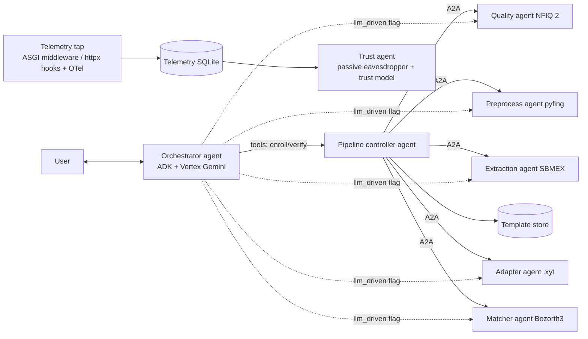
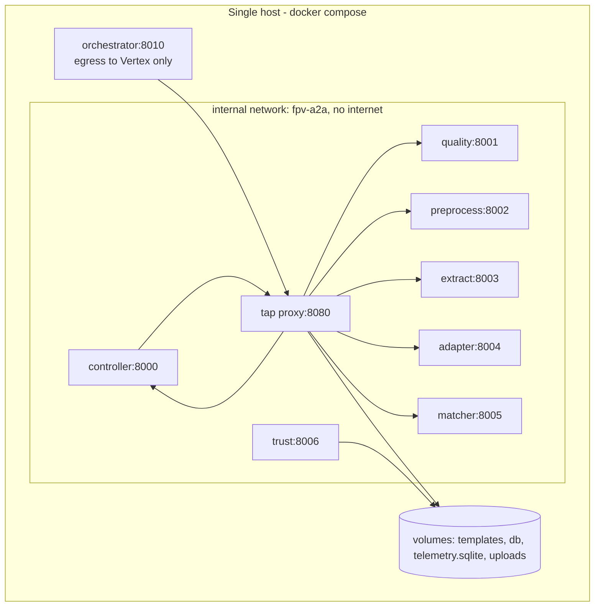

# Design Document: Multi-Agent Trust Telemetry (Phase 2)

> **Status: design reference only. Not scheduled.** Library versions and APIs named here (Google ADK, a2a-sdk, OpenTelemetry) must be re-verified and pinned when phase 2 is scheduled. ADK's A2A support was marked experimental at the time of writing.

## Overview

Phase 2 wraps each phase 1 module contract as an A2A skill, puts a Vertex AI Gemini orchestrator (Google ADK) in front as the user interface, and captures all A2A interaction telemetry for a passive trust agent. The research question is whether that telemetry (timing, sizes, structure and visible content) predicts genuine versus impostor presentations, and how much signal it carries beyond the matcher's own decision.

Design principles:

- **Deterministic core.** Only the orchestrator calls an LLM. The controller, stage agents, tap and trust agent are deterministic, so telemetry variance comes from the pipeline and the experiment flags, not from hidden model behavior.
- **Parity first.** In `controller` mode, phase 2 must reproduce phase 1 results exactly (Req 2.3). Telemetry differences can then be attributed to the agent boundary rather than to logic changes.
- **Passive observation.** The tap and trust agent never alter traffic or decisions.
- **Open by design.** No obfuscation (Req 13). Measured leakage is an upper bound.

## Architecture



### Deployment



- **Topology.** Every agent's peer URL points at the tap proxy, with the target agent selected by host header or path prefix, so all hops cross one observation point. This models a network eavesdropper.
- **Images.** All agents share a base image built from the phase 1 Dockerfile runtime stage (Req 3.3).
- **CPU pinning.** `cpuset` pins each container to fixed cores. Host load (`/proc/loadavg`, CPU steal) is sampled per run (Req 3.4).
- **Egress.** Only the orchestrator container has an egress network. Every other container is attached only to the internal network (Req 3.2).

## Framework Selection

| Option | Vertex AI | A2A | Fit |
|---|---|---|---|
| Google ADK (Python) | Native | Expose/consume built in (`to_a2a`, `RemoteA2aAgent`, experimental) | Orchestrator |
| a2a-sdk (Python) | n/a | Reference SDK (`AgentExecutor`, AgentCard, JSON-RPC/HTTP) | Deterministic stage agents and the trust agent |
| LangGraph | Via `langchain-google-vertexai` | Through adapters | Strong state machines, weaker native A2A |
| Pydantic AI | Supported | FastA2A | Viable, smaller ecosystem |

**Recommendation:** use ADK for the orchestrator and plain a2a-sdk servers for the controller, stage agents and trust agent.

- **ADK** provides Vertex Gemini integration, function tools, and the `before_tool_callback`/`after_tool_callback`/`after_model_callback` hooks needed for guardrails. It also has OpenTelemetry tracing.
- **a2a-sdk** servers (`AgentExecutor` plus a Starlette/FastAPI app with a task store) keep deterministic agents free of LLM machinery and give direct control over message shape, which is the object of study.
- **Rejected:** LangGraph adds a second orchestration model with weaker native A2A. Pydantic AI's FastA2A is viable, but it would mean two less common stacks.

## Components and Interfaces

### Agent roster and AgentCard skills

| Agent | Container | Skill ID | Input (phase 1 contract) | Output (phase 1 contract) | LLM |
|---|---|---|---|---|---|
| Quality | `quality` | `assess_quality` | image (FilePart PNG) | `QualityResult` (DataPart) | No |
| Preprocess | `preprocess` | `preprocess` | image (FilePart) + `AttemptConfig` + `configuration_id` (DataPart) | `PreprocessResult`: enhanced, mask (FileParts) + metadata (DataPart) | No |
| Extraction | `extract` | `extract` | enhanced, mask (FileParts) + attempt metadata | `ExtractionResult` (DataPart, minutiae list) | No |
| Adapter | `adapter` | `to_xyt` | `ExtractionResult` + `original_shape` + `scale_factor` | `XytTemplate` (DataPart and `.xyt` FilePart) | No |
| Matcher | `matcher` | `match` | probe, gallery `.xyt` (FileParts) | `MatchResult` (DataPart) | No |
| Controller | `controller` | `enroll`, `verify` | sample (FilePart or ref) + `Identity` + session info | `EnrollmentOutcome` / `VerificationOutcome` | No |
| Trust | `trust` | `assess_trust` | `run_id` | `{run_id, trust_score, model_version, feature_set_version}` | No |
| Orchestrator | `orchestrator` | (user-facing, optional `to_a2a`) | conversation + upload | result message | Yes (Gemini) |

- `quality_after` in phase 2 is a controller call to the quality agent with the inverted, masked, 500 ppi enhanced image. This adds a hop per attempt and keeps NFIQ 2 in one agent.
- Data parts carry JSON produced from the phase 1 frozen dataclasses through a shared `fpv_contracts` package of pydantic models mirroring them. The JSON schema is published in each AgentCard skill description.
- Artifact transport defaults to inline FileParts (base64 bytes), so payload size reflects content. An `artifact_transport: inline | uri` option (shared-volume URIs) exists for an ablation (open decision).

### Stage agent wrapper

A generic `StageAgentExecutor(skill_fn, input_model, output_model)` does the following:

1. Parses parts and validates them against `input_model`. On failure it returns a `rejected` or `failed` task (Req 1.6).
2. Calls the unchanged phase 1 function.
3. Serializes the output into DataParts and FileParts.
4. Maps phase 1 exceptions to A2A `failed` with an error code (`nfiq2_tool_error`, `insufficient_minutiae`, ...) (Req 1.5).
5. Emits task state transitions `submitted → working → completed | failed`.

Each agent loads its models at startup. Warm-up requests are tagged `warmup=true` (Req 3.5).

### Controller agent

The phase 1 `PipelineController` runs with an `A2AStages` implementation of the `Stages` protocol, where each method is an A2A client call through the tap. Storage stays local to the controller (Req 2.2). A parity test runs N seeded trials through `LocalStages` and `A2AStages` and asserts identical outcomes (Req 2.3). The `run_id` and W3C `traceparent` travel in A2A message metadata and HTTP headers (Req 2.4).

### Orchestrator agent (ADK)

- An ADK `LlmAgent` with a Vertex Gemini model. Project, region and model ID come from the environment (for example `GOOGLE_CLOUD_PROJECT`, `GOOGLE_CLOUD_LOCATION`, `FPV_MODEL_ID`). Credentials come from ADC (Req 14.4).
- Tools in `controller` mode: `confirm_claim(user_id, hand, finger)`, `enroll(sample_ref, user_id, hand, finger)` and `verify(...)`. These are ADK function tools that call the controller agent over A2A through the tap.
- Tools in `llm_driven` mode: `confirm_claim` plus `assess_quality`, `preprocess`, `quality_after`, `extract`, `to_xyt`, `persist_template`, `lookup_template` and `match`. All go through the policy wrapper.
- Uploads land in an `uploads` volume. The model sees only `sample_ref` (an opaque ID) unless `orchestrator_vision=on`, in which case the image is attached as an inline image part to the user turn (Req 7.2, 7.3).
- Session state (ADK session) holds `confirmed_claim`, `presentation_no` and `run_ids`.

### Guardrail design

| Guardrail | Mechanism | Requirement |
|---|---|---|
| Argument schemas | Pydantic models on every tool, plus `before_tool_callback` validation; on failure the call is blocked, an error goes back to the model, and `guardrail_block` is logged | 5.1, 5.2 |
| Identity confirmation | `confirm_claim` records the claim only after an explicit user "yes" turn; `before_tool_callback` blocks `enroll`/`verify` unless the args equal `confirmed_claim` | 5.3 |
| Verbatim results | `after_tool_callback` stores the tool status; `after_model_callback` checks the response's stated outcome against it and substitutes the deterministic message template on mismatch | 5.4 |
| Upload checks | Size and dimension limits, decode check; with vision `off`, a local likeness check (GMFS foreground ratio ≥ minimum, NFIQ 2 runs) | 5.5, 5.6 |
| Policy wrapper (`llm_driven`) | Per-run state machine `START → QUALITY_OK → (PREPROCESSED → QA_DONE → EXTRACTED)×≤max_attempts → ADAPTED → {PERSISTED | LOOKED_UP → MATCHED}`; thresholds and decisions are applied in the wrapper; illegal transitions return a policy error and log `policy_violation` | 6.4, 6.5, 6.6 |
| Presentation cap | The orchestrator session counter mirrors phase 1 `max_presentations` | 4.4 |
| Vision egress gate | `FPV_ALLOW_BIOMETRIC_EGRESS=true` is required to start with `orchestrator_vision=on` | 7.4 |

### Telemetry tap

Three complementary capture layers, all writing to `telemetry.sqlite`:

1. **Tap proxy** (primary, the eavesdropper view). This is a small ASGI reverse proxy (Starlette plus httpx) on the internal network that every A2A URL routes through. For each request/response it records wall and monotonic timestamps, byte sizes, headers, the JSON-RPC body (method, task ID, context ID, part kinds) and the response task state. It forwards bytes unchanged (Req 9.3).
2. **Server middleware** in each a2a-sdk app. It records server-side receive and send times and handler duration, which lets proxy latency be split into queueing, processing and transfer.
3. **OpenTelemetry spans.** ADK tracing plus manual spans in the controller and policy wrapper are exported to a local OTLP collector, then to SQLite. These give the causal tree and model-call records (Req 4.5, 9.4).

Overhead: the tap measures its own forwarding time per hop. Runs exceeding a configured budget (for example 2 ms per hop at p95) are flagged (Req 9.5).

## Data Models

### Telemetry schema (`telemetry.sqlite`, versioned migrations)

```sql
CREATE TABLE telemetry_runs (
  run_id TEXT PRIMARY KEY, session_id TEXT, operation TEXT,
  control_mode TEXT NOT NULL, orchestrator_vision TEXT NOT NULL,
  model_id TEXT, config_set_id TEXT NOT NULL, pipeline_version TEXT NOT NULL,
  image_digests_json TEXT NOT NULL, biometric_egress INTEGER NOT NULL,
  harness TEXT, seed INTEGER, trial_id TEXT, warmup INTEGER NOT NULL DEFAULT 0,
  host_load_json TEXT, started_at TEXT, ended_at TEXT
);

CREATE TABLE a2a_hops (
  hop_id INTEGER PRIMARY KEY AUTOINCREMENT,
  run_id TEXT, trace_id TEXT, span_id TEXT, parent_span_id TEXT,
  src_agent TEXT NOT NULL, dst_agent TEXT NOT NULL, skill_id TEXT,
  jsonrpc_method TEXT, a2a_task_id TEXT, a2a_context_id TEXT,
  http_status INTEGER, final_task_state TEXT, error_code TEXT,
  t_send_wall TEXT, t_send_mono_ns INTEGER, t_recv_mono_ns INTEGER, latency_ms REAL,
  server_handle_ms REAL, tap_overhead_ms REAL,
  req_bytes INTEGER, resp_bytes INTEGER, part_kinds_json TEXT,
  req_payload_json TEXT, resp_payload_json TEXT,   -- open system: content is captured
  captured_by TEXT NOT NULL                          -- tap | middleware | otel
);

CREATE TABLE task_transitions (hop_id INTEGER REFERENCES a2a_hops, seq INTEGER, state TEXT, t_mono_ns INTEGER);

CREATE TABLE model_calls (
  call_id INTEGER PRIMARY KEY AUTOINCREMENT, run_id TEXT, model_id TEXT,
  input_tokens INTEGER, output_tokens INTEGER, latency_ms REAL,
  tool_calls_json TEXT, vision_parts INTEGER, t_mono_ns INTEGER
);

CREATE TABLE guardrail_events (run_id TEXT, kind TEXT, tool TEXT, detail_json TEXT, t_mono_ns INTEGER);
  -- kind: guardrail_block | policy_violation | response_substituted

CREATE TABLE trust_features (run_id TEXT, feature_set_version TEXT, features_json TEXT, PRIMARY KEY (run_id, feature_set_version));
CREATE TABLE trust_scores   (run_id TEXT, model_version TEXT, score REAL, created_at TEXT, PRIMARY KEY (run_id, model_version));

-- Written only by the batch harness. Not readable by the trust agent's DB role/connection (Req 10.2, 10.3).
CREATE TABLE labels (run_id TEXT PRIMARY KEY, genuine INTEGER, alteration TEXT, difficulty TEXT, split TEXT);
```

SQLite has no roles, so label isolation is enforced by keeping `labels` in a separate `labels.sqlite` file mounted only into the harness and the offline training job, never into the trust agent container.

## Trust Model

### Labels

- **Primary:** `genuine` (1) or `impostor` (0) per verification run.
- **Secondary (stratification and auxiliary tasks):** alteration type (Obl, CR, Zcut) and difficulty (Easy, Medium, Hard).

### Features (per run, `feature_set_version` tracked)

| Group | Examples |
|---|---|
| Timing | Total run latency; per-skill latency and server handling time; inter-hop gaps; preprocess and extract latency per attempt; orchestrator model latency |
| Size | Request and response bytes per skill; enhanced image FilePart size (compressibility proxy); `.xyt` payload size |
| Structure | Number of hops; attempts used (count of preprocess calls); sequence n-grams of skills; task state paths; error codes; guardrail and policy events |
| Visible content | `quality_before`, `quality_after` per attempt, raw and adapted minutiae counts, Bozorth3 score, decision |
| LLM (orchestrator runs) | Tool-call count and order, tokens, retries by the model |

The visible-content group includes the match score and decision, so a model using it will trivially approach the matcher's performance. The ablations isolate leakage that exists without content: timing, size and structure only.

### Models and evaluation

- **Models:** logistic regression (interpretable baseline) and gradient-boosted trees (scikit-learn `HistGradientBoostingClassifier`). Hyperparameters are tuned on validation.
- **Splits:** the phase 1 subject-disjoint splits. Train on train runs, tune on validation, test once (Req 12.1).
- **Metrics:** ROC AUC, EER, Brier score and reliability curves, and mutual information `I(feature group; label)` via a k-NN estimator, with bootstrap confidence intervals over subjects.
- **Comparison with the matcher:** agreement with the Bozorth3 decision, and AUC of `match_score` alone versus `match_score + non-content telemetry` (incremental AUC) (Req 12.4).
- **Stratification:** by `control_mode`, `orchestrator_vision`, alteration and difficulty (Req 12.5).

### Confounds and mitigations

| Confound | Effect | Mitigation |
|---|---|---|
| LLM nondeterminism (`llm_driven`, orchestrator) | Variable tool sequences and timing unrelated to the sample | Fixed temperature/seed where supported; R repeats per trial; variance decomposition (Req 12.7) |
| Warm-up / model loading / caches | First calls are slow | Warm-up runs excluded; probe cache disabled for telemetry experiments |
| Host load and CPU contention | Timing noise | `cpuset` pinning; load sampled per run; randomized trial order |
| Image dimensions (96×103 vs 241×298) | Size and timing correlate with image class, not genuineness | Stratify or restrict to the dominant size; report both |
| Trial ordering | Drift over time | Randomized interleaving of genuine and impostor trials with a fixed seed |
| Genuine/impostor share the same probe | The same probe yields both labels, so probe-only features (quality, minutiae) can't separate them | Report this explicitly; the signal for genuineness must come from the match hop or the claim-dependent path |
| Altered-only probes | Every probe is altered; no "Real probe" baseline | Optional auxiliary run with Real probes for reference, outside the main protocol |

## Error Handling

- A stage agent failure becomes an A2A `failed` task with an error code. The controller maps it to the phase 1 status per the phase 1 error table.
- If the tap proxy is down, agents fail closed with a connection error and the run ends `ERROR`. No silent bypass of the tap is allowed in experiment mode.
- A Vertex AI error or quota exhaustion makes the orchestrator report a transient error to the user without fabricating a result, and the run is marked `ERROR` with `reason=model_unavailable`.
- Guardrail blocks and policy violations are returned to the model as tool errors and logged. Repeated violations (over a configured count) end the session.

## Testing Strategy (when scheduled)

- **Contract tests:** each agent's AgentCard and skill schema round-trip against phase 1 dataclasses.
- **Parity tests:** `LocalStages` and `A2AStages` give identical outcomes on seeded trials (Req 2.3).
- **Guardrail tests:** scripted model outputs (a fake LLM) attempt bad args, unconfirmed calls, contradicting summaries and out-of-order stage calls. Each must be blocked or substituted.
- **Tap tests:** byte-for-byte forwarding, completeness (every hop recorded), and an overhead budget.
- **Label isolation test:** the trust agent container cannot open `labels.sqlite`.
- **Experiment pipeline tests:** feature extraction is deterministic for fixed telemetry, and ablation masks drop the intended columns.

## Data Handling Notes

- All modes send conversation text to Vertex AI. Only `orchestrator_vision=on` sends fingerprint pixels (Req 14.1). `biometric_egress` is stored per run (Req 14.2).
- Before enabling vision: review the SOCOFing license (believed to restrict use to non-commercial research), plus course and IRB rules, and set the explicit egress acknowledgement (Req 7.4, 14.3).
- Inter-agent authentication is disabled by default and the system is unobfuscated by design (Req 13). Do not expose agent ports beyond the host.

## Open Decisions

- Gemini model (for example a Flash vs Pro tier), GCP project and region.
- Artifact transport default (`inline` vs `uri`) and whether to run both as an ablation.
- Tap proxy vs middleware as the canonical latency source for features.
- Number of repeats R for `llm_driven` trials, given Vertex cost.
- Whether `confirm_claim` requires a free-text "yes" or a structured UI confirmation in the chat surface (ADK web UI vs custom).
