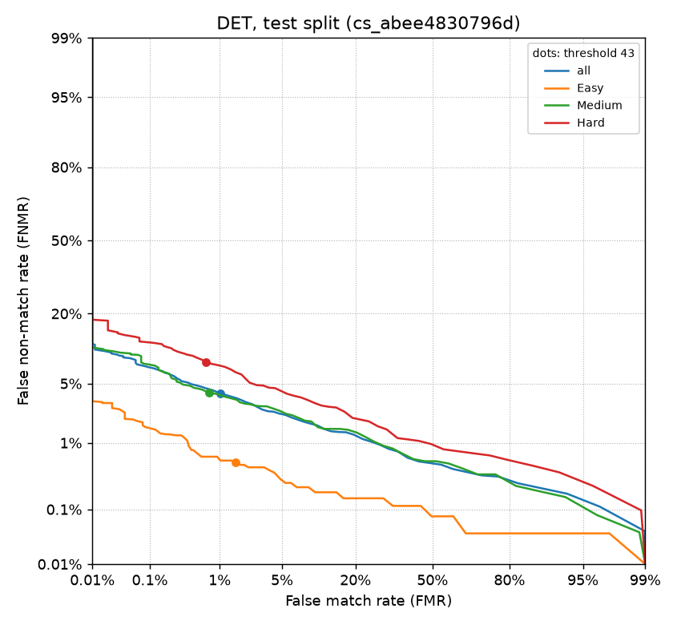

# Evaluation: test split

- config: `/app/configs/pipeline.v1.frozen.yaml` (config_set_id `cs_abee4830796d`, frozen: True)
- pipeline_version: `0.1.0+g61e588a.dirty`
- thresholds: bozorth3_match 43, nfiq2_min 5, minutiae_min 12
- seed 42, impostors per probe 5, subjects 90, workers 10, elapsed 1735 s
- enrollments 896, trials 44160 (7360 genuine, 36800 impostor), probes skipped (finger not enrolled in the split) 0, probe cache hits 36800
- runs and artifacts: `store/<Hand>_<finger>/fpv.sqlite` (one store per finger position)

## Overall at the active threshold

| metric | value | counts |
|---|---:|---|
| FTE | 1.12% | 10 of 896 enrollments not ENROLLED |
| FTA | 1.79% | 132 of 7360 probes rejected |
| FMR | 1.02% | 364 of 35745 impostor comparisons |
| FNMR | 3.92% | 283 of 7216 genuine comparisons |
| generalized FMR | 1.00% | (1 - FTA) x FMR |
| generalized FNMR | 5.64% | FTA + (1 - FTA) x FNMR |

Excluded from the rates: 407 NOT_ENROLLED trials (claimed finger failed to enroll) and 0 ERROR trials.

Score medians: genuine 208, impostor 12; impostor max 132.

## By alteration

| alteration | probes | FTA | genuine | FNMR | impostor | FMR | gFNMR | gFMR | not enrolled | errors |
|---|---:|---:|---:|---:|---:|---:|---:|---:|---:|---:|
| Obl | 2678 | 1.76% | 2627 | 2.32% | 13016 | 0.94% | 4.04% | 0.92% | 143 | 0 |
| CR | 2448 | 1.96% | 2394 | 7.73% | 11866 | 0.69% | 9.54% | 0.68% | 140 | 0 |
| Zcut | 2234 | 1.66% | 2195 | 1.69% | 10863 | 1.47% | 3.31% | 1.45% | 124 | 0 |

## By difficulty

| difficulty | probes | FTA | genuine | FNMR | impostor | FMR | gFNMR | gFMR | not enrolled | errors |
|---|---:|---:|---:|---:|---:|---:|---:|---:|---:|---:|
| Easy | 2670 | 1.42% | 2630 | 0.53% | 13014 | 1.58% | 1.95% | 1.55% | 148 | 0 |
| Medium | 2562 | 1.91% | 2508 | 3.99% | 12421 | 0.72% | 5.82% | 0.71% | 149 | 0 |
| Hard | 2128 | 2.11% | 2078 | 8.13% | 10310 | 0.67% | 10.08% | 0.66% | 110 | 0 |

## By difficulty x alteration

| difficulty x alteration | probes | FTA | genuine | FNMR | impostor | FMR | gFNMR | gFMR | not enrolled | errors |
|---|---:|---:|---:|---:|---:|---:|---:|---:|---:|---:|
| Easy / Obl | 894 | 1.79% | 878 | 0.91% | 4344 | 1.50% | 2.68% | 1.47% | 46 | 0 |
| Easy / CR | 887 | 1.58% | 872 | 0.46% | 4317 | 1.34% | 2.03% | 1.32% | 49 | 0 |
| Easy / Zcut | 889 | 0.90% | 880 | 0.23% | 4353 | 1.88% | 1.13% | 1.87% | 53 | 0 |
| Medium / Obl | 891 | 1.57% | 876 | 2.40% | 4337 | 0.58% | 3.93% | 0.57% | 49 | 0 |
| Medium / CR | 829 | 2.05% | 809 | 7.79% | 4010 | 0.27% | 9.68% | 0.27% | 53 | 0 |
| Medium / Zcut | 842 | 2.14% | 823 | 1.94% | 4074 | 1.33% | 4.04% | 1.30% | 47 | 0 |
| Hard / Obl | 893 | 1.90% | 873 | 3.67% | 4335 | 0.74% | 5.50% | 0.72% | 48 | 0 |
| Hard / CR | 732 | 2.32% | 713 | 16.55% | 3539 | 0.37% | 18.49% | 0.36% | 38 | 0 |
| Hard / Zcut | 503 | 2.19% | 492 | 3.86% | 2436 | 0.99% | 5.96% | 0.96% | 24 | 0 |

## Status counts

| trial | status | count |
|---|---|---:|
| genuine | MATCH | 6933 |
| genuine | NOT_ENROLLED | 12 |
| genuine | NO_MATCH | 283 |
| genuine | REJECTED_MINUTIAE | 9 |
| genuine | REJECTED_QUALITY | 123 |
| impostor | MATCH | 364 |
| impostor | NOT_ENROLLED | 395 |
| impostor | NO_MATCH | 35381 |
| impostor | REJECTED_MINUTIAE | 45 |
| impostor | REJECTED_QUALITY | 615 |

| enrollment status | reason | count |
|---|---|---:|
| ENROLLED |  | 886 |
| REJECTED_MINUTIAE | insufficient_minutiae | 1 |
| REJECTED_QUALITY | below_threshold | 7 |
| REJECTED_QUALITY | nfiq2_failed | 2 |

## DET

