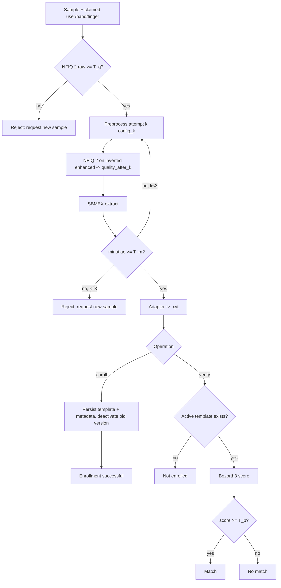
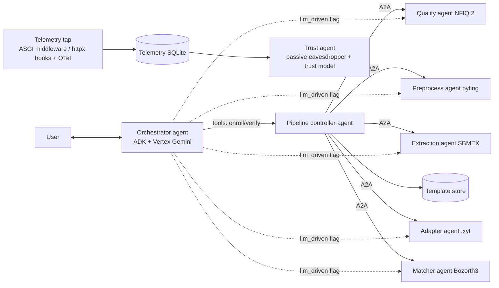

**Implementation Plan: SOCOFing fingerprint verification pipeline (phase 1) and multi-agent architecture (phase 2 design)**

**Problem Statement**
We'll build a working, reproducible fingerprint enrollment and verification pipeline over SOCOFing:

- **NFIQ 2** checks quality.
- **pyfing** handles preprocessing and minutiae extraction, as two separate modules.
- **A template adapter** writes minutiae out as `.xyt` files.
- **Bozorth3** does the matching.
- **SQLite** stores templates and metadata.

Each stage sits behind a module boundary that phase 2 can wrap as an A2A agent. The phase 2 system will have a Vertex AI orchestrator, stage agents, telemetry capture and a trust/eavesdropper agent. It gets documented now so later decisions stay consistent. The end goal is to test whether A2A interaction telemetry carries a trust signal.

Research question: Can A2A interaction leakage act as a signal for trust establishment in a multi-agent fingerprint verification system?

**Requirements**

*Evaluation protocol*
- Enroll Real images and probe with Altered ones (Easy, Medium, Hard).
- A genuine trial is a probe from the same user, hand and finger. An impostor trial is any other combination.
- Respect the existing duplicate exclusions and the subject-disjoint 70/15/15 split (`data/processed/dataset_splits.csv`).

*Phase 1 interface*
- An interactive CLI asks for an image path, user ID, hand and finger.
- It can also run non-interactively for batch runs.

*Quality gate*
- NFIQ 2 checks the raw sample in both pipelines, with a low threshold (default 5).
- If the sample fails, the system asks for a new one.

*Preprocessing and retries*
- Up to 3 deterministic attempts:
  1. The traditional chain: GMFS, GBFOE, XSFFE, GBFEN.
  2. The deep-learning chain: SUFS, SNFOE, SNFFE, SNFEN.
  3. The attempt-2 chain plus CLAHE and/or 2× upscaling, plus SBMEX tuning.
- Every attempt extracts with SBMEX and gets a `configuration_id`.
- After each attempt, NFIQ 2 scores the enhanced image. For enrollments the scores are stored in the template metadata. For both pipelines they're logged as events.
- If no attempt yields the minimum minutiae count (default 12), the system asks for a new sample.

*Adapter*
- Converts pyfing minutiae into `.xyt` the same way for enrollment and verification.
- Maps coordinates back to the original 500 ppi pixel space.

*Enrollment*
- Stores the `.xyt` file and its metadata: `template_id`, `user_id`, `hand`, `finger`, `template_location`, `source_sample_id`, `quality_before`, `quality_after`, `minutiae_count`, `pipeline_version`, `configuration_id`, `created_at` and `template_version`.
- Re-enrolling creates a new version and marks the old one inactive.
- Shows a success message.

*Verification*
- Looks up the active template for the claimed identity.
- Runs Bozorth3, applies the threshold and reports match or no match.
- If the claimed identity has no template, it reports "not enrolled".

*Sessions*
- Up to 3 new-sample attempts per session.
- Every attempt is logged, including rejections.

*Thresholds*
- Start with the provisional defaults: NFIQ 2 ≥ 5, at least 12 minutiae and a Bozorth3 score ≥ 40.
- Calibrate on the train and validation splits at a target FAR (0.1% and 1%).
- Freeze the chosen values into a versioned config, then evaluate once on the test split.

*Runtime*
- One Linux Docker image with NBIS (Bozorth3), NFIQ 2 v2.3 and pyfing 0.7.3. Phase 2 splits it per agent.
- Use official sources only.

*Phase 2 (design only)*
- A Vertex AI Gemini orchestrator replaces the CLI as the user interface. The CLI stays as the batch and evaluation harness.
- `control_mode`: `controller` (default) has the LLM call the high-level `enroll` and `verify` tools. `llm_driven` lets the LLM call stage agents directly under policy guardrails.
- `orchestrator_vision`: `off` (default) means the image is passed by reference with a local check that it looks like a fingerprint. `on` sends the image to Gemini as multimodal input.
- Both flags are recorded on every run.
- The system stays open and is assumed secure, so messages aren't obfuscated.

*Minor decisions*
- NFIQ 2 runs through its official CLI as a subprocess.
- `.xyt` files go under a gitignored `data/templates/` directory.
- The design doc lives at `docs/architecture.md`.
- Tests use pytest.

**Background**

*Repo*
- Data under `data/raw/Real` and `data/raw/Altered/Altered-{Easy,Medium,Hard}`. All of `data/` except `processed/dataset_splits.csv` is gitignored.
- Existing scripts in `data_preprocessing/` handle label parsing (`validate_labels.py`), SHA-256 duplicate conflicts (`handle_duplicate.py`, 235 excluded samples) and the splits (`split_dataset.py`, seed 42).
- No pipeline code or tests exist yet. `requirements.txt` has kaggle, numpy, pandas, opencv-python-headless, matplotlib.

*SOCOFing*
- 500 ppi BMP images, mostly 96×103 px (54,837), with 433 at 241×298.
- Filenames look like `100__M_Left_index_finger_CR.BMP`, with an uppercase extension.
- One Real impression per finger. The Altered images are synthetic edits of it (Obl, CR, Zcut).

*pyfing 0.7.3*
- `Minutia(x, y, direction, type, quality)`. Origin is top-left, direction is `atan2(-dy, dx)` in radians (counterclockwise, y up), type is E/B, and quality is 0–1.
- SBMEX defaults: `minimum_background_distance=10` px and `minutia_quality_threshold=0.3`. SBMEX ignores `dpi`; its distances are pixel counts.
- Segmentation, orientation, frequency and enhancement all resize to 500 dpi internally when `dpi != 500`, then resize back. A 2× upscale only changes SBMEX's effective border exclusion and thinning resolution. Lowering `minimum_background_distance` is an alternative to compare.
- SBMEX uses `cv.ximgproc.thinning`, which needs `opencv-contrib-python-headless`. That conflicts with `opencv-python-headless`, so replace it.
- The enhanced image has white ridges on a black background, so it gets inverted before NFIQ 2 scores it.

*NFIQ 2 v2.3*
- Scores range 0–100. There's no minimum size check since v2.2, so small images get padded and score low.
- Reliable input is 8-bit grayscale BMP or PNG. It also reports actionable feedback, such as foreground area and uniformity.
- Ships .deb packages for Ubuntu 22.04 and 24.04 (amd64 and arm64).

*Bozorth3*
- `.xyt` holds `x y theta [quality]`, with origin at bottom-left and theta in degrees from 0 to 359.
- It needs at least 10 minutiae to compute a score, and keeps up to 150 by quality.
- It compares relative angles, so any consistent angle offset doesn't affect scores.
- Building NBIS 5.0.0 on modern GCC needs `-fcommon`.

*Frameworks for phase 2*

| Option | Vertex AI | A2A | Fit |
|---|---|---|---|
| Google ADK (Python) | Native | Expose/consume built in (`to_a2a`, `RemoteA2aAgent`, experimental) | Orchestrator |
| a2a-sdk (Python) | n/a | Reference SDK (`AgentExecutor`, AgentCard, JSON-RPC/HTTP) | Deterministic stage agents and the trust agent |
| LangGraph | Via `langchain-google-vertexai` | Through adapters | Strong state machines, weaker native A2A |
| Pydantic AI | Supported | FastA2A | Viable, smaller ecosystem |

Recommendation: ADK for the orchestrator and plain a2a-sdk servers for the stage agents. The stage agents call no LLM, which keeps their telemetry deterministic.

**Proposed Solution**

*Phase 1 layout*
```
docker/Dockerfile            # multi-stage: build bozorth3 -> ubuntu:24.04 + nfiq2 .deb + python deps
docker-compose.yml           # mounts data/raw read-only; data/templates, data/db writable
configs/pipeline.v1.yaml     # thresholds, retry attempts, tool versions
src/fpv/
  catalog.py      # SOCOFing filename parsing, split/exclusion lookup, ground truth
  imaging.py      # load -> 8-bit gray, CLAHE, resize, invert, PNG write
  quality.py      # NFIQ 2 CLI wrapper -> QualityResult(score, feedback)
  preprocess.py   # pyfing chain per attempt config -> PreprocessResult(enhanced, mask, scale)
  extract.py      # SBMEX -> list[Minutia]
  adapter.py      # Minutia -> .xyt (unscale, y-flip, deg mod 360, quality 0-100)
  matcher.py      # bozorth3 wrapper -> score; decision vs threshold
  storage.py      # SQLite repository + artifact paths
  pipeline.py     # controller: enroll()/verify(), gates, bounded retries, event log
  cli.py          # interactive + non-interactive entry points
  evaluate.py     # batch trials, FMR/FNMR, FTE/FTA per alteration level
  calibrate.py    # threshold selection at target FAR, config freeze
tests/            # pytest; markers: dataset (needs data/raw), toolchain (needs nfiq2/bozorth3)
docs/architecture.md
```
Each stage module exposes one pure function with typed input and output dataclasses. That function becomes the A2A skill in phase 2.

*Pipeline flow*

After any rejection, the CLI asks for a new sample, up to 3 times per session.

*SQLite schema* (`data/db/fpv.sqlite`)
- `samples`: `sample_id`, `source_path`, `sha256`, `subject_id`, `hand`, `finger`, `alteration`, `difficulty`, `split`, `width`, `height`
- `templates`: the required fields, plus `scale_factor`, `quality_after` (JSON list, one entry per attempt) and `is_active`. A partial unique index on (`user_id`, `hand`, `finger`) where `is_active=1` keeps one active template per finger.
- `runs`: `run_id`, `session_id`, `operation`, the claimed identity, `sample_id`, `status`, `attempts_used`, `control_mode`, `orchestrator_vision` (both default for phase 1), `started_at`, `ended_at`
- `stage_events`: `run_id`, `stage`, `attempt_no`, `configuration_id`, `started_at`, `duration_ms`, `outcome`, `details_json`. This is the in-process baseline we'll compare A2A telemetry against later.
- `verifications`: `run_id`, `template_id`, `probe_location`, `score`, `threshold`, `decision`, `ground_truth_genuine`

`configuration_id` is a short hash of the canonical JSON of the attempt config, the adapter parameters and the tool versions. `pipeline_version` is the package version plus the git commit.

*Phase 2 architecture* (documented, not built)

- One container per agent, on one host network so network latency doesn't affect the measurements.
- Each agent publishes an AgentCard with its skills.
- Telemetry features per A2A hop: timestamps, latency, request and response payload sizes, message counts, task state transitions, retry counts, error codes, and visible payload fields such as NFIQ 2 scores, minutiae counts and match scores. The system is open, so these fields are readable.
- Labels for the trust model: genuine or impostor, plus alteration type and level.
- The trust model learns from telemetry only. We'll measure its AUC and mutual information against the ground truth, compare it with Bozorth3's own decision, and break results down by `control_mode` and `orchestrator_vision`.
- Confound to address: LLM nondeterminism in `llm_driven` mode affects telemetry.
- Orchestrator guardrails:
  - Schema-validated tool arguments: an allow-list for hand and finger, and an integer user ID from 1 to 600.
  - A required confirmation step for the claimed identity before any call.
  - Results returned verbatim from tool outputs, with no decision made by the LLM itself.
  - In `llm_driven` mode, a policy wrapper enforces the stage order, the retry bound and the fixed thresholds.
- Data handling: `orchestrator_vision=on` sends biometric images to GCP. Check the SOCOFing license (believed to restrict use to non-commercial research) and any course or IRB rules before enabling it.

**Task Breakdown**

Task 1: Toolchain container and test scaffold
- Objective: A reproducible Docker image where `nfiq2`, `bozorth3` and pyfing all run, plus a pytest skeleton.
- Guidance:
  - Use a multi-stage Dockerfile. The builder stage fetches the official NIST NBIS 5.0.0 source and builds only Bozorth3 (and its library dependencies) with `CFLAGS=-fcommon`.
  - The runtime stage starts from `ubuntu:24.04`, installs the NFIQ 2 v2.3 .deb chosen by `TARGETARCH`, Python 3.12 and pinned versions of `pyfing==0.7.3`, TensorFlow/Keras 3, `opencv-contrib-python-headless`, numpy, pandas, pyyaml and pytest.
  - Replace `opencv-python-headless` in `requirements.txt` to avoid the conflict.
  - Add `docker-compose.yml` with the data mounts, a `pyproject.toml` with the `src/fpv` package, and the pytest markers `dataset` and `toolchain`.
- Tests: Smoke tests check that `nfiq2` runs, that `bozorth3` prints its usage, that pyfing imports and `cv.ximgproc` exists, and that the SUFS weights load.
- Demo: `docker compose run fpv pytest -m toolchain` passes, and `docker compose run fpv nfiq2 <a SOCOFing image>` prints a score.

Task 2: Dataset catalog and image I/O
- Objective: Turn a SOCOFing file path into ground-truth labels and a normalized 8-bit grayscale image.
- Guidance: Reuse the regex from `validate_labels.py`, and handle the uppercase `.BMP` extension. Load `dataset_splits.csv` for the split and exclusion flags. Write `imaging.py` helpers for loading, CLAHE, resizing, inverting and writing temporary PNGs. Write a `samples` row builder that includes the SHA-256 hash.
- Tests: Parse every label pattern (Real and the three alterations). Reject malformed names. Flag excluded samples. Check that a loaded image is uint8, 2-D and the original size. These run on synthetic fixtures; only one `dataset` test touches the real data.
- Demo: `fpv catalog <path>` prints the subject, hand, finger, alteration, difficulty and split.

Task 3: Quality module (NFIQ 2)
- Objective: `assess_quality(image) -> QualityResult(score, actionable_feedback, raw_output)` plus a gate function.
- Guidance: Write the image to a temporary 8-bit grayscale PNG, call the `nfiq2` CLI through a subprocess with an argument list, and parse the score and feedback into a typed result. Map NFIQ 2 failures, such as a blank image, to a defined `QualityError` instead of crashing. Read the threshold from the config.
- Tests: A blank image is handled. A real Real sample returns a score from 0 to 100 (`toolchain`, `dataset`). The gate passes and fails around the threshold, using a mocked subprocess.
- Demo: `fpv quality <image>` prints the score, the feedback and PASS or FAIL.

Task 4: Preprocessing module (pyfing chain, attempt configs)
- Objective: `preprocess(image, attempt_config) -> PreprocessResult(enhanced, mask, scale_factor, configuration_id, timings)`.
- Guidance:
  - Define the three attempt configs as frozen dataclasses in `configs/pipeline.v1.yaml`: (1) GMFS, GBFOE, XSFFE, GBFEN; (2) SUFS, SNFOE, SNFFE, SNFEN; (3) the attempt-2 chain plus CLAHE and a 2× upscale with `dpi=1000` passed through, plus an SBMEX parameter override.
  - Compute `configuration_id` from the canonical JSON.
  - Load the models once per process.
  - Add `quality_after()`, which inverts the enhanced image, applies the mask and calls `assess_quality`.
- Tests: Output shapes match the input times the scale. The function is deterministic, giving identical output for repeated calls. `configuration_id` stays the same for the same config and changes when any parameter changes. `quality_after` returns a score.
- Demo: `fpv preprocess <image> --attempt 2 --out enhanced.png` saves the enhanced image and prints `quality_after`.

Task 5: Extraction module plus a characterization study
- Objective: `extract(preprocess_result) -> ExtractionResult(minutiae, count)`, plus measured evidence for freezing the retry policy and the provisional minutiae floor.
- Guidance: Run SBMEX on the enhanced image and mask, passing SBMEX overrides from the attempt config. Add `scripts/characterize.py`, which samples about 200 fingers from the train split. For Real and each Altered level, it records NFIQ 2 on the raw image, `quality_after`, minutiae counts and timing for every attempt. Compare upscaling against simply lowering `minimum_background_distance`, then update `pipeline.v1.yaml` from the results.
- Tests: Extraction on a synthetic ridge pattern returns minutiae with coordinates inside the mask. A real sample yields more than 0 minutiae (`dataset`).
- Demo: A Markdown or CSV report in `data/quality_reports/characterization/` shows the share of samples passing each gate at each attempt.

Task 6: Template adapter (`.xyt`)
- Objective: `to_xyt(minutiae, original_height, scale_factor) -> list[str]`, plus file write and read.
- Guidance:
  - `x' = round(x / s)`
  - `y' = (H - 1) - round(y / s)`
  - `theta = round(degrees(direction)) mod 360`
  - `q = round(quality * 100)`
  - Deduplicate minutiae that land on the same point after rounding. Sort deterministically. Version the adapter as part of `configuration_id`.
- Tests: Hand-computed cases for the y-flip and angle wrap. Unscaling at s=2. A property test that rotating synthetic minutiae by φ before conversion shifts every theta by exactly φ (mod 360). A round trip through write and read.
- Demo: `fpv extract <image> --out probe.xyt` writes a valid `.xyt` file.

Task 7: Matcher module (Bozorth3)
- Objective: `match(probe_xyt, gallery_xyt) -> MatchResult(score)` and `decide(score, threshold)`.
- Guidance: Call `bozorth3` through a subprocess with an argument list and parse the integer score. Check both templates for at least 10 minutiae before calling, and return a typed `InsufficientMinutiae` error otherwise.
- Tests (`toolchain`): Self-match scores far above 40. A cross-subject pair scores low. Integration with Tasks 4–6 on a Real versus Altered-Easy pair of the same finger (`dataset`).
- Demo: `fpv match probe.xyt gallery.xyt` prints the score and the decision.

Task 8: Storage layer
- Objective: A SQLite repository and artifact store implementing the schema above.
- Guidance: Use stdlib `sqlite3` with parameterized queries and migrations as versioned SQL files. Store `.xyt` files at `data/templates/<user>/<hand>_<finger>/v<n>.xyt` and add `data/templates/` and `data/db/` to `.gitignore`. Re-enrollment runs in one transaction that deactivates the old template, inserts the new one and increments the version. Add `get_active_template(user, hand, finger)`, plus logging for runs, stage events and verifications.
- Tests: Using a temporary database: the enrollment then re-enrollment version chain, the one-active-template constraint, a missing template returning None, and every required metadata field being persisted.
- Demo: A script enrolls a fake template twice, then lists both versions with `is_active` flags.

Task 9: Pipeline controller (`enroll` and `verify`)
- Objective: End-to-end orchestration of Tasks 3–8 with the quality gate, bounded retries, status codes and event logging.
- Guidance:
  - `enroll(sample_path, user_id, hand, finger) -> EnrollmentOutcome` and `verify(...) -> VerificationOutcome`.
  - Statuses: `ENROLLED`, `REJECTED_QUALITY`, `REJECTED_MINUTIAE`, `MATCH`, `NO_MATCH`, `NOT_ENROLLED` and `ERROR`.
  - Every stage call is wrapped to emit a `stage_events` row with its timing.
  - Verification records `ground_truth_genuine` from the catalog for later evaluation.
  - Keep the controller free of I/O prompts so it can become the controller agent in phase 2.
- Tests: Mocked stages exercise every branch: a quality failure, retry success on attempt 2, giving up after attempt 3, not enrolled, match and no match. A `dataset` integration test enrolls a Real image, then verifies its Altered-Easy version and a different subject.
- Demo: A Python call enrolls `1__M_Left_index_finger.BMP` and verifies its `_CR` variant, printing `MATCH` along with the event trail.

Task 10: Interactive CLI
- Objective: The user-facing phase 1 interface.
- Guidance:
  - `fpv enroll` and `fpv verify` prompt for the image path, then ask the user to confirm the user ID, hand and finger.
  - Input is validated: user 1–600, hand Left or Right, finger from the five-value allow-list.
  - A rejection asks for a new sample, up to 3 times, then ends the session.
  - Messages: "Enrollment successful (template v<n>)", "Match", "No match", "Not enrolled" and the rejection reasons.
  - Non-interactive flags such as `--image --user --hand --finger --yes` support scripting.
- Tests: CLI tests with mocked input cover invalid inputs being re-asked, the 3-attempt cap and success messages.
- Demo: In the container, enroll a Real image interactively, then verify an Altered image of the same finger and see "Match", then verify a different subject's image and see "No match".

Task 11: Batch evaluation harness
- Objective: Large-scale labeled trials that measure baseline accuracy and seed future telemetry datasets.
- Guidance:
  - `fpv evaluate --split train`: enroll every non-excluded Real image in the split, then run genuine trials (every Altered probe against its own finger) and impostor trials (each Altered probe against k=5 random templates of other subjects with the same hand and finger).
  - Use a fixed seed and run in parallel processes.
  - Write `scores.csv` and a summary: FTE, FTA, FMR and FNMR at the current threshold, broken down by alteration type and level.
- Tests: Trial generation on a small synthetic catalog checks disjoint genuine and impostor sets, determinism under the seed and correct labels. The metric functions are checked against hand-computed confusion counts.
- Demo: A run on a 50-subject subset produces the report and a DET plot.

Task 12: Threshold calibration and config freeze
- Objective: Data-driven thresholds and a frozen `pipeline.v1` config.
- Guidance: `fpv calibrate` uses the train and validation scores to choose the Bozorth3 threshold at FAR 0.1% and 1%, and reports FTE and FTA trade-offs across NFIQ 2 cutoffs. It writes `configs/pipeline.v1.frozen.yaml` with a new `configuration_id`, then runs the test split once with the frozen config and produces the final baseline report.
- Tests: Threshold selection on synthetic score distributions hits the target FAR. The frozen config is loaded by the CLI.
- Demo: `data/quality_reports/baseline_v1.md` with the test-split FMR, FNMR, FTE and FTA by alteration level.

Task 13: Architecture document and README
- Objective: A reference for phase 2 decisions.
- Guidance: `docs/architecture.md` covers:
  - The phase 1 pipeline and its module contracts, which become the agent skills.
  - The framework comparison and the ADK plus a2a-sdk recommendation.
  - Agent roster and AgentCards.
  - Orchestrator guardrails and the two experiment flags.
  - Telemetry capture design and schema.
  - The trust and eavesdropper agent and the trust-model experiment design: features, labels, metrics and confounds such as LLM nondeterminism.
  - Data-handling notes: biometric data going to Vertex when `orchestrator_vision=on`, and SOCOFing license terms.
  - The container layout.

  Update the README with setup, run and test instructions.
- Tests: none. A docs link check is optional.
- Demo: Review the document with Tyler against the phase 2 scope.

Notes:
- **Licensing and data handling.** Phase 1 sends no data off the machine. Phase 2 with `orchestrator_vision=on` sends fingerprint images to GCP. Check the SOCOFing license and any course or IRB rules before you enable it.
- **Defaults are provisional.** The retry policy and minutiae floor get finalized after Task 5's measurements, and the match threshold after Task 12.
